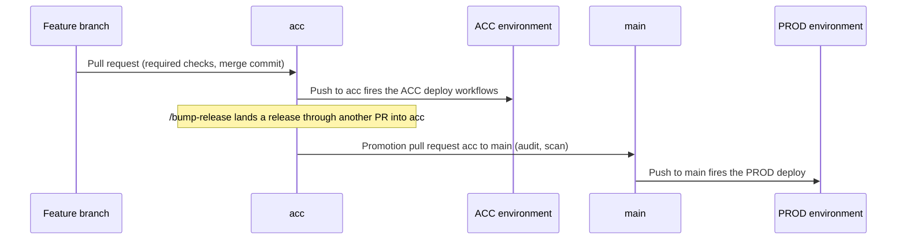

# Branches & Promotion

Every repository works with two long-lived branches: `acc`, which deploys to acceptance, and `main`, which deploys
to production. On GitHub, a ruleset on each branch makes a pull request the only way in, with named checks that must
pass and merge commits as the only merge method. A change reaches production in two pull requests: one into `acc`,
then a promotion from `acc` into `main`.

## How it works

1. **Branch from `acc`.** Work happens on a feature branch; nothing is committed to `acc` or `main` directly.
2. **Pull request into `acc`.** The `acc` ruleset requires a pull request and a set of passing status checks (table
   below). The deploy workflows run on the pull request too, so their build, lint and test jobs are among the required
   checks. No approval count is required.
3. **ACC deploy.** Merging pushes `acc`, and the push fires the acceptance deploy workflows (path-filtered, see
   below). CPRMV's `ci.yml` publishes an image and waits for the acceptance VM to run it.
4. **Release.** `/bump-release` sets the version, writes the release SBOM ([Build Provenance](build-provenance.md)) and
   lands both through a pull request into `acc` like any other change.
5. **Promotion pull request `acc` → `main`.** The `main` ruleset requires a pull request and passing `audit` and
   `scan` (CPRMV: also `test` and `build`).
6. **PROD deploy.** Merging pushes `main`. The Linked Data Explorer and the RONL Business API run one
   `Promote to Production` workflow that deploys the backend first and the sites after it; the CPSV Editor runs its
   PROD Static Web App workflow; CPRMV's stable VM pulls the new image.

## What blocks a merge

Every ruleset is `active`, has **no bypass actors**, requires a pull request with **0 approvals**, allows the `merge`
method only, blocks deletion and non-fast-forward pushes, and does not require the branch to be up to date with its
base (`strict_required_status_checks_policy: false`).

| Component | `acc` ruleset: required checks | `main` ruleset: required checks |
|---|---|---|
| CPSV Editor | `audit`, `scan`, `lockfile-review`, `Build and deploy ACC` | `audit`, `scan` |
| Linked Data Explorer | `audit`, `scan`, `lockfile-review`, `deploy`, `Build and Deploy Frontend`, `Build and Deploy ROPA Site` | `audit`, `scan` |
| RONL Business API | `audit`, `scan`, `lockfile-review`, `build`, `Build and Deploy ACC Frontend`, `Build and Deploy ACC PA Demo`, `Build and Deploy ACC Public Site` | `audit`, `scan` |
| CPRMV | `audit`, `scan`, `test`, `build` | `audit`, `scan`, `test`, `build` |
| Norm Editor | no `acc` branch | none: `main` is a protected branch on GitLab, but Maintainers may push to it directly and force-push is allowed, and a merge does not need a passing pipeline |

Where the check names come from:

| Check | Workflow | What it is documented on |
|---|---|---|
| `audit`, `lockfile-review` | `zizmor.yml` (Supply-chain audit) | [Pinning](supply-chain.md), [Dependencies](dependency-scanning.md) |
| `scan` | `semgrep.yml` | [Dependencies](dependency-scanning.md) |
| `Build and deploy ACC`, `deploy`, `build`, `Build and Deploy …` | the ACC deploy workflows | [Tests & Coverage Gates](coverage-floor.md) |
| `test`, `build` (CPRMV) | `ci.yml` | [Tests & Coverage Gates](coverage-floor.md) |

The merge method is also a repository setting. The three applications allow merge commits only and delete the head
branch on merge. CPRMV's repository settings still allow squash and rebase, but both rulesets pin
`allowed_merge_methods` to `merge`, so only a merge commit can land; head branches are not deleted on merge.

### Path-filtered deploys as required checks

A required check must report on every pull request, or a pull request that does not touch the watched paths could
never merge. So the ACC deploy workflows of the Linked Data Explorer and the RONL Business API put **no** path filter
on `pull_request`: a first `changes` job compares the pull request's files with the workflow's paths, and the build
job is skipped by its own `if:` when nothing relevant changed. A skipped job reports success. If `changes` fails, the
build runs. The `push` trigger keeps its `paths:` filter, because nothing is required on a push.

The CPSV Editor's ACC workflow filters `push` with `paths-ignore` (`docs/**`, `.claude/**`, `**/*.md`) and has no path
filter on `pull_request`. `zizmor.yml` and `semgrep.yml` have no branch or path filter on `pull_request` in any
repository, so `audit` and `scan` report on every pull request, whatever its base.

## Deploys per branch

| Component | `acc` push deploys | `main` push deploys | Path filter on push |
|---|---|---|---|
| CPSV Editor | Azure Static Web App `orange-beach` (`Deploy ACC (orange-beach)`) | Azure Static Web App `white-sky` (`Deploy PROD (white-sky)`) | `paths-ignore`: docs, `.claude`, Markdown |
| Linked Data Explorer | App Service `ronl-linkeddata-backend-acc`; Static Web Apps for the frontend and the ROPA site | `promote-to-production.yml`: backend (`ronl-linkeddata-backend-prod`), then frontend and ROPA site | ACC: `paths:` per workflow. PROD: none; `scripts/promotion-targets.mjs` decides which deploys run |
| RONL Business API | App Service `ronl-business-api-acc`; Static Web Apps for the frontend, PA demo and public site | `promote-to-production.yml`: backend (`ronl-business-api-prod`), then frontend, PA demo and public site | ACC: `paths:` per workflow. PROD: none; `scripts/promotion-targets.sh` decides |
| CPRMV | `ci.yml` pushes `ghcr.io/open-regels/cprmv-api` and waits for `acc.cprmv.open-regels.nl` to run the commit | the same, for `cprmv.open-regels.nl` (environment `stable`) | none |
| Norm Editor | no `acc` branch | `.gitlab-ci.yml` builds and pushes six images to Azure Container Registry; no deploy job | none |

CPRMV's VMs pull rather than receive: a reconciler (`deployment/vm/reconciler/reconcile.sh`, a systemd timer every 2
minutes per tier) reads the head of its branch on GitHub, pulls the image tagged `sha-<commit>` by digest, starts it,
checks `/health`, and restores the previous release if that fails. The `deploy` job in `ci.yml` waits on the VM's
`deploy-status.json` until it reports the pushed commit.

The production promotions in the Linked Data Explorer and the RONL Business API call the individual production deploy
workflows as reusable workflows (`workflow_call`); those workflows have no push trigger of their own. Each one has a
`workflow_dispatch` trigger for deploying a single part by hand. In the Linked Data Explorer the `production`
environment accepts deployments from `main` only; the other repositories' environments carry no protection rules.

## Releases

| Component | Release number | Where it is written | Tags |
|---|---|---|---|
| CPSV Editor | CalVer `YYYY.MM.N` (`2026.11.3`) | `package.json`, `package-lock.json`, `src/data/changelog.json` | none |
| Linked Data Explorer | CalVer `YYYY.MM.N`, one sequence for all packages | the in-scope `package.json` files, the lockfile, the frontend's `changelog.json` | none |
| RONL Business API | CalVer `YYYY.MM.N` | the in-scope `package.json` files, the lockfile, `changelog-data.ts` | none |
| CPRMV | `vYYYY.MM.N` release beside a vocabulary version (`v2026.11.1`, vocabulary `0.4.3`) | `serve_api/RELEASE` (validated by `scripts/read-release.sh`); vocabulary in `serve_api/pyproject.toml` | image tags `:vYYYY.MM.N` and `:<vocabulary>` on stable; no git tags |
| Norm Editor | git tags `YYYY.MM.N` (`2026.07.0`, `2026.07.1`) plus a SemVer version per service | tags; `versions.json`, set by `scripts/bump-version.mjs` | git tags; `scripts/generate-changelog.mjs` groups commits by tag |

The commit that cuts a release is `chore: bump release to v<version>`. This site prints every release with a `v`
prefix.

`/bump-release` in the three applications cuts the release on a working branch and opens the pull request into `acc`;
it does not promote. The promotion is a separate pull request from `acc` into `main`, titled
`chore: promote acc to main …` (CPSV Editor: `release: promote acc to main …`); a promotion without a release cut says
so in its title. In CPRMV, `/bump-release` runs the whole path: the release pull request into `acc`, the promotion
pull request into `main`, confirmation that stable runs the release, and the push of `main` to GitLab. In every
repository the command opens pull requests and the user merges them.

## What it does not cover

- **No review requirement.** Every ruleset requires 0 approvals; a pull request can be merged by its author once the
  checks pass.
- **`main` requires the scanners only.** For the three applications no build or test is a required check on the
  promotion pull request. Some PROD workflows build a preview on that pull request (CPSV Editor, the Linked Data
  Explorer's frontend and ROPA site), but none of them is required; the production build and its tests run after the
  merge.
- **No up-to-date requirement.** A pull request can merge with a base that has moved since its checks ran.
- **The GitLab side is unprotected by these rulesets.** The mirrors are pushed by hand ([The GitLab Mirror](the-gitlab-mirror.md)).
- **Norm Editor.** Its pipeline runs on GitLab on `main`, `develop` and tags; the test jobs run on every pipeline, and
  nothing in `.gitlab-ci.yml` gates a merge. Branch protection on GitLab was not verified.

## Where it lives

| What | Where |
|---|---|
| Rulesets | GitHub → Settings → Rules → Rulesets (`acc supply-chain gate`, `main promotion gate`); `gh api repos/<owner>/<repo>/rulesets` |
| Merge methods, branch deletion | GitHub → Settings → General → Pull Requests |
| Environments | GitHub → Settings → Environments |
| ACC / PROD deploys | `.github/workflows/azure-*.yml`, `promote-to-production.yml` (LDE, RBA); `ci.yml` and `deployment/vm/` (CPRMV) |
| Promotion targets | `scripts/promotion-targets.mjs` (LDE), `scripts/promotion-targets.sh` (RBA) |
| Release command | `.claude/commands/bump-release.md` in each GitHub repository |
| RBA promotion runbook | `docs/promote-ACC-to-PROD.md` in `ronl-business-api` |
| Norm Editor pipeline | `.gitlab-ci.yml`, `versions.json`, `scripts/bump-version.mjs` in `regels/editor` |
