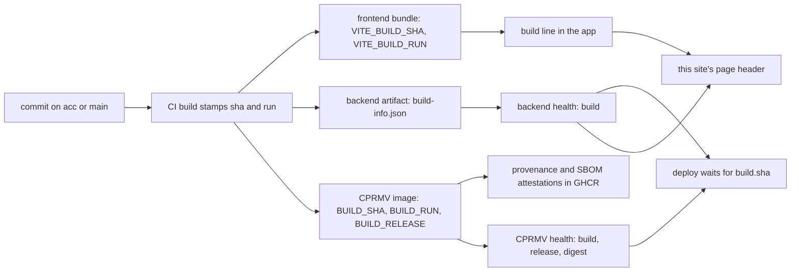

# Build Provenance

A release number says which version is meant; it does not say which build is running. Deploys are path-filtered and
can happen without a release, so two environments at the same version can run different code. Each CI build
therefore stamps the commit SHA and the Actions run number into what it ships, the running application reports them,
and the deploy waits until it does. Each release also commits a bill of materials (SBOM).

## How it works

1. **Stamp.** The deploy workflows pass `github.sha` and `github.run_number` into the build: as `VITE_BUILD_SHA` and
   `VITE_BUILD_RUN` for a Vite frontend, as a `build-info.json` (`sha`, `run`, `runId`) written into the backend's
   deployment package, and as Docker build arguments for the CPRMV image.
2. **Report.** The frontends print a build line, `build <sha7> · #<run>`, in their changelog panel or footer. The
   backends and CPRMV return the build in their health response.
3. **Verify the deploy.** The backend deploy workflows of the Linked Data Explorer and the RONL Business API poll the
   health endpoint until `build.sha` equals the commit they deployed, and fail if it never does. CPRMV's `ci.yml`
   smoke-tests the image's `/health` against the commit before and after pushing, then waits for the VM to report it.
4. **Record.** CPRMV's published image carries a signed build-provenance attestation and a BuildKit SBOM attestation.
   Every release commits a CycloneDX SBOM under `docs/sbom/`.
5. **Show here.** This site's page header for a component prints the build recorded for it.

A build line counts as tracked only when both values are present (CPSV Editor: when the SHA is present). Anything
else, such as a local development build, reads `local build`. A backend reads its `build-info.json` once, when the
process starts, so a process that is still serving after a new package is unpacked reports its own build, not the new
one.

## Per repository

| Component | Build line in the app | Health endpoint and its build field | Deploy waits for the SHA | Attestation | Release SBOM |
|---|---|---|---|---|---|
| CPSV Editor | changelog tab (`ChangelogTab.jsx`) | no backend | no | not in place | `docs/sbom/ttl-editor-<version>.cdx.json` |
| Linked Data Explorer | frontend changelog (`Changelog.tsx`); the ROPA site has none | `/v1/health` → `build`: `sha`, `shortSha`, `run`, `isTracked`, `label` | yes, backend ACC and PROD (also waits for `shacl.complete`) | not in place | `docs/sbom/linked-data-explorer-<version>.cdx.json` |
| RONL Business API | frontend changelog panel; public-site footer; the PA demo has none | `/v1/health` → `data.build`: `sha`, `run`, `runId`, or `null` when not recorded | yes, backend ACC and PROD | not in place | `docs/sbom/ronl-business-api-<version>.cdx.json` |
| CPRMV | no frontend | `/health` → `version` (vocabulary), `release`, `environment`, `build.sha`, `build.run`, `image.digest` | yes, via `deploy-status.json` and `/health` | build provenance (`actions/attest-build-provenance`) and BuildKit SBOM, both stored with the image in GHCR | `docs/sbom/cprmv-api-<release>.cdx.json` |
| Norm Editor | not found in source | not found in source | no deploy job | not in place | not in place |

The live health endpoints:

| Component | ACC | PROD |
|---|---|---|
| Linked Data Explorer | `https://acc.backend.linkeddata.open-regels.nl/v1/health` | `https://backend.linkeddata.open-regels.nl/v1/health` |
| RONL Business API | `https://acc.api.open-regels.nl/v1/health` | `https://api.open-regels.nl/v1/health` |
| CPRMV | `https://acc.cprmv.open-regels.nl/health` | `https://cprmv.open-regels.nl/health`, and `/deploy-status.json` |

On the verified date each of these reported the pinned `acc` or `main` head as its `build.sha`.

In production, the Linked Data Explorer and the RONL Business API deploy every part of a promotion as jobs of one
`Promote to Production` run ([Branches & Promotion](branch-protection.md)), so the backend and the frontends report the
same run number. The Linked Data Explorer's backend writes `runId` into `build-info.json` but does not return it.

### CPRMV's image

The `publish` job of `ci.yml` builds `ghcr.io/open-regels/cprmv-api` with `BUILD_SHA`, `BUILD_RUN` and `BUILD_RELEASE`
(from `serve_api/RELEASE`), sets the OCI label `org.opencontainers.image.revision` to the SHA, and tags it
`sha-<commit>` and `acc` or `stable`; on `main` also `:<vocabulary>` and `:vYYYY.MM.N`. It pushes with `sbom: true`,
re-runs the `/health` smoke test against the pushed digest, and attests build provenance for that digest
(`push-to-registry: true`). The VM's reconciler pulls `sha-<commit>`, resolves it to a digest, and passes the digest to
the container as `CPRMV_IMAGE_DIGEST`, which `/health` returns. `deploy-status.json` reports the target and running
SHA, the running digest and the last attempt.

### Norm Editor

`.gitlab-ci.yml` tags each of its six images with `CI_COMMIT_SHA` and `latest` in Azure Container Registry, on
`main`, `develop` and tags. That is the only build identifier it records; no build line, health field, attestation or
SBOM was found.

## Release SBOMs

`sbom.yml` (`Release SBOM`) runs on a push to `main`, on demand, and on pull requests that touch the SBOM tooling or
`docs/sbom/`. There are no git tags or GitHub Releases: the commit on `main` is the release.

| Step | What it checks |
|---|---|
| Release pull request (the one that changes this version's SBOM file) | the committed SBOM matches the lockfile exactly (`--check`) |
| Promotion (push to `main`) | the SBOM for the released version exists; drift is a warning (`--verify-release`) |
| Every run | generates the SBOM and uploads it as artifact `sbom-<sha>`, kept 90 days |

The committed file is the durable copy; the artifact is for a scanner to fetch without a checkout. The applications
generate it with `scripts/write-sbom.mjs` (production dependencies, from the lockfile); CPRMV with
`scripts/write-sbom.py` (the hash-locked `serve_api/requirements.txt`, via `cyclonedx-py`). CPRMV's Debian packages
are in the BuildKit SBOM attestation, not in the committed file. `/bump-release` writes the file: `npm run sbom`, then
`npm run sbom:check`, in the applications; `python scripts/write-sbom.py` in CPRMV.

## This site's header

`docs/repo-versions.json` may record, per component, a `build` object: `sha`, `run` and `run_url`, the build that was
serving the recorded environment at the recorded commit. `hooks/repo_versions.py` loads the file at build time and
`overrides/partials/doc-meta.html` prints it in the header of a component page as `build <sha> · #<run>`, linked to
the run, beside the version (and, for CPRMV, the vocabulary version). A reader can compare it with the build line or
health response of the running application. The recorded value is set when the documentation is synced; the site
build does not query any endpoint.

Cross-cutting pages such as this one carry a `verified` stamp instead: the commit of each component the page was last
checked against, linked to the repository where that component's CI runs (GitHub for all but the Norm Editor), where
the deploy runs for that commit are listed.

## What it does not cover

- **No attestations for the three applications.** Their artifacts (Static Web App bundles, App Service packages) are
  not signed or attested; the build line and `build-info.json` are unsigned values set by the workflow.
- **Pull request builds stamp a synthetic SHA.** On a pull request `github.sha` is the merge commit GitHub creates,
  not a commit on the branch.
- **Not every surface has a build line**: the Linked Data Explorer's ROPA site and the RONL Business API's PA demo do
  not stamp one.
- **The CPSV Editor's deploy does not verify which build is serving.**
- **The Norm Editor** records only the image tag.
- **The application SBOMs cover npm dependencies**, not the runtime or the hosting platform.

## Where it lives

| What | Where |
|---|---|
| Frontend build line | `src/utils/buildInfo.js` (CPSV Editor); `packages/frontend/src/utils/buildInfo.ts` (LDE, RBA); `packages/public-site/src/lib/buildInfo.ts` (RBA) |
| Backend build | `packages/backend/src/utils/buildInfo.ts` and `routes/health.routes.ts` (LDE); `packages/backend/src/utils/build-info.ts` and `routes/health.routes.ts` (RBA) |
| Stamping and the SHA wait | the `azure-*` deploy workflows: `VITE_BUILD_*` on the build step, "Prepare deployment package" writes `build-info.json` |
| CPRMV | `.github/workflows/ci.yml`, `serve_api/Dockerfile`, `serve_api/src/serve.py` (`/health`), `scripts/smoke-health.sh`, `deployment/vm/reconciler/reconcile.sh` |
| SBOMs | `.github/workflows/sbom.yml`, `scripts/write-sbom.mjs` or `scripts/write-sbom.py`, `docs/sbom/` |
| This site | `docs/repo-versions.json`, `hooks/repo_versions.py`, `overrides/partials/doc-meta.html` |
