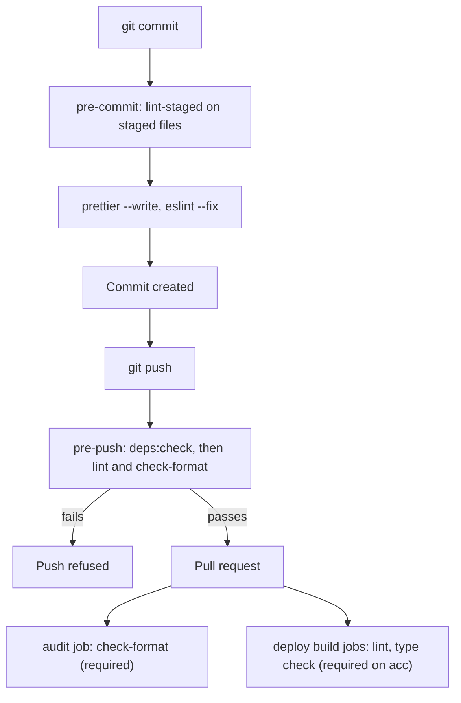

# Code Standards & Hooks

This page covers lint, format and type checks, and the git hooks that run them. In the
three applications, Husky runs `lint-staged` on commit and the full lint and format check
on push. CI then repeats the checks: `check-format` in the required `audit` job, and lint
(plus the type check where one exists) in the required deploy build jobs. CPRMV runs
shellcheck and nothing else of this kind. The Norm Editor's hooks check commit messages
and regenerate its changelog; they do not lint.

## How it works

1. **`pre-commit`** runs `npx lint-staged`. Only staged files are formatted with
   `prettier --write` and fixed with ESLint's `--fix`. The results are added to the commit.
2. **`pre-push`** runs `npm run deps:check` first. It stops with `npm ci` named when the
   install no longer matches `package-lock.json`, so the next checks run on the locked
   tool versions. After that, it runs the repository-wide checks (table below).
3. **CI.** `audit` runs `npm run check-format` on every pull request and on pushes to `acc`
   and `main`. It is required on both branches. The deploy workflows' build jobs run
   `lint` (and the type check) before the tests. They are required on `acc`
   ([Tests & Coverage Gates](coverage-floor.md)).

The hooks are installed by Husky's `prepare` script, which runs during `npm ci` or
`npm install`. Husky points `core.hooksPath` at `.husky/_`, a generated folder that git
does not track.

## Per repository

| | Lint | Format | Type check | `pre-commit` | `pre-push` | In CI |
|---|---|---|---|---|---|---|
| **CPSV Editor** | ESLint 9, `eslint .` | Prettier, `check-format` = `prettier --check .` | none (JavaScript) | `lint-staged`: `src/**` gets `prettier --write` and `eslint --fix`; `package.json` gets `prettier --write` | `deps:check`, `lint`, `check-format` | `check-format` in `audit`; `lint` in both deploy jobs |
| **Linked Data Explorer** | ESLint 9 in both workspaces | Prettier per workspace (backend `src/**/*.ts`, frontend `.`) | `typecheck` = `tsc --noEmit` per workspace | `lint-staged`: `prettier --write` and `eslint --config <workspace> --fix` for frontend files and backend `src/**/*.ts` | `deps:check`, `check-rip-bpmn`, `lint`, `check-format` | `check-format` and `check-rip-bpmn` in `audit`; `lint`, `typecheck` (and backend `lint:openapi`) in the deploy jobs |
| **RONL Business API** | ESLint 9 (backend), ESLint 8 (frontend, pa-cockpit, pa-demo, public-site); Stylelint, report-only | Prettier at the root, `**/*.{ts,tsx,json,md}` | `type-check` = `tsc --noEmit` per workspace | `lint-staged`: each workspace's `lint:fix` and `prettier --write`; shared and `*.{json,md}` get `prettier --write` | `deps:check`, build `@ronl/shared`, `check-swimlane-fixtures`, `type-check`, `lint`, `check-format` | `check-format`, `check-swimlane-fixtures`, `check-shared` and `test:stylelint` in `audit`; `lint` in the deploy jobs; `type-check` in the PA Demo and Public Site jobs; `tsc` in the backend and frontend builds |
| **CPRMV** | shellcheck on tracked `*.sh` (the runner's version); no Python linter is run | none run | none run | not in place | not in place | `test` job: `py_compile`, import check, shellcheck |
| **Norm Editor** | gui: `npm run lint` (ESLint 9, Vue and Quasar presets); backend: none | gui: `npm run format` (writes, no check); `gui/.editorconfig` | none (JavaScript) | regenerates `gui/public/changelog.json` | Conventional Commit subjects | not in place: the pipeline runs tests only |

**Configuration.**

| | ESLint config | Prettier config | Notes |
|---|---|---|---|
| CPSV Editor | `eslint.config.mjs` (flat; React, hooks, jsx-a11y, import, simple-import-sort, Vitest, Testing Library; `eslint-plugin-prettier` last) | `.prettierrc`: single quotes, width 100, `es5` commas, `endOfLine: auto` | `eslint .` also covers `e2e/`, config files and `scripts/` |
| Linked Data Explorer | `packages/{backend,frontend}/eslint.config.js` (flat, `typescript-eslint`, type-aware via `tsconfig`; `eslint-config-prettier`) | `packages/backend/.prettierrc`, `packages/frontend/.prettierrc.json`: single quotes, width 100, `es5` commas, `lf` | backend lint also gates `eqeqeq`, `prefer-const`, `no-var` |
| RONL Business API | `packages/backend/eslint.config.mjs` (flat, `typescript-eslint`); `packages/*/.eslintrc.cjs` elsewhere | root `.prettierrc`: single quotes, width 100, `es5` commas, `lf`; Prettier pinned at `3.10.1` | `stylelint.config.mjs` sets every rule to a warning: `npm run lint:css` measures and always exits 0. The one CSS gate is `css-hex.test.ts` in the frontend suite |

`lint-staged` in the RONL Business API calls `npm run lint:fix --workspace=…`, which is
`eslint . --fix`. It therefore lints the whole workspace, not only the staged files.

## The Norm Editor is shaped differently

The Norm Editor lives on GitLab (`regels/editor`) and has five services: `gui` (Vue and
Quasar), `backend` (Express) and three Flask APIs. There is no root `package.json`. Its
hooks are plain shell scripts in `.githooks/`, and they are **opt-in**: each clone enables
them once with `git config core.hooksPath .githooks`.

| Hook | What it does |
|---|---|
| `commit-msg` | Rejects a subject that is not `type(scope)!: subject`. The allowed types are `feat`, `fix`, `perf`, `refactor`, `docs`, `test`, `build`, `ci`, `style`, `chore` and `revert`. Merge, revert, fixup, squash and amend subjects are exempt. |
| `pre-commit` | Runs `scripts/generate-changelog.mjs --out gui/public/changelog.json` and stages the result. It is skipped when `node` is absent. |
| `pre-merge-commit` | Runs `pre-commit`, so merge commits also carry a fresh changelog. |
| `pre-push` | Checks every outgoing non-merge commit subject against the same pattern. |

`.gitlab-ci.yml` runs no lint, format or type check. The `test` stage runs `npm test` in
`gui/` and `backend/` (after `npm i`) and `pytest` in each Python API. The `build_gui`
job runs `generate-changelog.mjs` in `docker:latest` before building the image. That image
has no Node, so the left side of the `&&` fails without failing the job, and the image
ships the committed `changelog.json`.

## CPRMV

`serve_api/pyproject.toml` lists `bandit`, `black`, `mypy`, `ruff` and `vulture` in its
`tools` extra, and `requirements-dev.txt` is compiled with `--extra=dev,tools`. CI
installs them, but no step or hook runs them. `pre-commit` is in the `dev` extra, but
there is no `.pre-commit-config.yaml`. The ruff setting is written under `[tools.ruff]`.
Ruff reads `[tool.ruff]`, so the `line-length = 120` setting is not applied. The CI
`test` job compiles and imports `src/serve.py` and runs shellcheck over every tracked
`*.sh` outside `rdf/`, plus the reconciler test stubs.

## What it does not cover

- **Hooks are local and skippable.** A clone that never ran `npm ci`/`npm install` has no
  hooks. The same goes for a `git worktree`, because `.husky/_` is untracked. `--no-verify`
  skips them too. The `audit` and deploy checks are what a pull request must pass.
- **A branch without a pull request gets no CI checks.** `audit` and the deploy workflows
  trigger on pull requests and on pushes to `acc` and `main` only.
- **`deps:check` trusts a marker.** It compares `package-lock.json` with
  `node_modules/.package-lock-installed.json`, which `postinstall` writes. The RONL Business
  API skips that write on `npm install --package-lock-only`. The CPSV Editor's and the
  Linked Data Explorer's `write-deps-marker.mjs` write it on every install, so after a
  lockfile-only install the check reports "in sync" over an older `node_modules`.
- **Commit messages are not enforced** in the four GitHub repositories. Only the Norm
  Editor checks them, and only where its hooks are enabled.
- **No type check runs in the CPSV Editor, CPRMV or the Norm Editor.** The RONL Business
  API's pa-cockpit is type-checked by `pre-push` but has no CI step of its own.
- **`.editorconfig`** exists only in the Norm Editor's `gui/`.

## Where it lives

| What | Where |
|---|---|
| Hooks | `.husky/pre-commit`, `.husky/pre-push` (CPSV Editor, Linked Data Explorer, RONL Business API); `.githooks/*` (Norm Editor) |
| `lint-staged` | the `lint-staged` key in the root `package.json` |
| Scripts | `lint`, `lint:fix`, `format`, `check-format`, `typecheck` / `type-check`, `deps:check` in each `package.json` |
| Install check | `scripts/check-deps.sh`, `scripts/write-deps-marker.{mjs,sh}` |
| CI | `audit` job in `.github/workflows/zizmor.yml`; deploy jobs in `.github/workflows/azure-*.yml`; CPRMV `.github/workflows/ci.yml`; Norm Editor `.gitlab-ci.yml` |
| Python tooling | CPRMV `serve_api/pyproject.toml` (`[project.optional-dependencies]`) |
