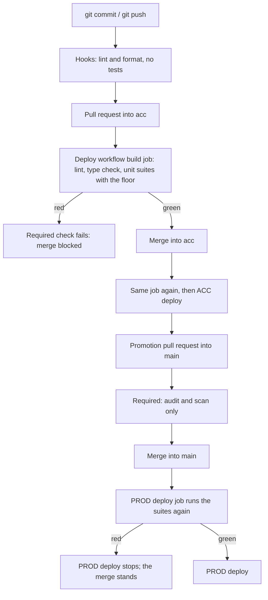

# Tests & Coverage Gates

This page answers two questions: where the test suites run on the way to production, and
what makes a run fail. In the three applications, the unit suites run in each deploy
workflow's build job, before the build. That job is a required check on `acc`, and the
suites carry an 80% **branch** floor **per file**. No git hook runs a test. CPRMV runs
its pytest and bats suites in a required `test` job. The Norm Editor runs its suites in
GitLab CI, and nothing there blocks a merge on them.

## How it works

1. **Locally.** `pre-commit` and `pre-push` run formatting, linting and (in the RONL
   Business API) type checks. None of them runs `npm test`. See
   [Code Standards & Hooks](code-standards.md).
2. **Pull request into `acc`.** Each deploy workflow triggers on `pull_request` to `acc`.
   Its build job runs `npm ci`, the linter, the type check where there is one and the unit
   suites, and only then builds. The deploy steps are skipped on a pull request. The
   rulesets name these jobs as required checks, so a red suite or a file under the floor
   blocks the merge ([Branches & Promotion](branch-protection.md)).
3. **Merge into `acc`.** The push runs the same job again and deploys to ACC.
4. **Promotion into `main`.** The `main` ruleset requires `audit` and `scan` only. No test
   job is required there.
5. **Merge into `main`.** The PROD deploy (`promote-to-production.yml` in the Linked Data
   Explorer and RONL Business API, the PROD Static Web Apps workflow in the CPSV Editor)
   runs lint and the suites again before it builds. A red run stops that deploy, but it
   cannot undo the merge.

## Per repository

| | Pre-push | PR into `acc` (required) | Before ACC deploy | PR into `main` | Before PROD deploy | End-to-end (Playwright) |
|---|---|---|---|---|---|---|
| **CPSV Editor** | no tests | `Build and deploy ACC`: `lint`, `test:ci` | same job | the PROD workflow runs `lint` and `test:ci` for its preview; not required | PROD workflow: `lint`, `test:ci` | `e2e/`, by hand only: needs the LDE backend and Operaton |
| **Linked Data Explorer** | no tests | `deploy` (backend): `lint`, `lint:openapi`, `typecheck`, `npm test`; `Build and Deploy Frontend`: `lint`, `typecheck`, `npm test` | same jobs | the frontend PROD workflow runs for its preview; not required | `promote-to-production.yml` calls the PROD workflows, which run the same steps | none |
| **RONL Business API** | no tests | `build` (backend): `lint`, `lint:openapi`, `npm test`, `tsc` build; `Build and Deploy ACC Frontend`: pa-cockpit and frontend suites, `test:perf`; `… PA Demo` and `… Public Site`: `lint`, `type-check`, `npm test`; PA Demo also its Playwright suite | same jobs | none | `promote-to-production.yml` calls the PROD workflows: the same steps, without the PA Demo end-to-end run | frontend: by hand, against a running stack; public-site: by hand; pa-demo: in the ACC job |
| **CPRMV** | no hooks | `test`: `py_compile`, import check, `pytest`, shellcheck, bats; `build`: image smoke test | `test` and `build` on the push to `acc` | `test` and `build`, required | `test` and `build` on the push to `main` | none |
| **Norm Editor** | no tests (hooks check commit messages) | no `acc` branch; the `test` stage runs on every pipeline | none | none required: `main` does not require a passing pipeline | `test` stage before `build` (images for `main`, `develop`, tags) | none |

A few more checks run in CI as their own small tests. Each script's `*.test.mjs` file runs
in the workflow that uses the script. Examples are `lockfile-diff` and the dependency gate
in `lockfile-review`, `promotion-targets` in `audit` and in the promotion, and the SBOM
generator in `sbom.yml`. CPRMV's `scripts/test/test_write_sbom.py` runs in `sbom.yml` on
a push to `main` and on pull requests that touch the SBOM tooling.

## Coverage floors

| Repository | Package | Runner | Config | Floor | Lines / functions / statements |
|---|---|---|---|---|---|
| CPSV Editor | (root) | Vitest, v8 | `vite.config.mjs` | branches 80, `perFile: true` | none |
| Linked Data Explorer | backend | Jest | `packages/backend/jest.config.js` | branches 80, glob key `./src/**/*.ts` (per file) | none |
| Linked Data Explorer | frontend | Vitest, v8 | `packages/frontend/vite.config.ts` | branches 80, `perFile: true` | none |
| RONL Business API | backend | Jest | `packages/backend/jest.config.js` | branches 80, glob key `./src/**/*.ts` (per file), plus the conformance check | none |
| RONL Business API | frontend, pa-cockpit, pa-demo, public-site | Vitest, v8 | each package's `vite.config.ts` (`vitest.config.ts` in pa-cockpit) | branches 80, `perFile: true` | none |
| RONL Business API | shared | — | — | no tests; `check-shared` in `audit` fails on any function, class, conditional or loop in the package | — |
| CPRMV | `serve_api` | pytest | none | no coverage measured (`pytest-cov` is installed, not invoked) | — |
| Norm Editor | gui, backend, three Python APIs | Vitest, pytest | `vitest.config.js`, none | no coverage measured | — |

**What the floor applies to.** Coverage reports every source file, not only the files a
test imports: Jest uses `collectCoverageFrom`, Vitest uses `coverage.include`. An untested
file therefore shows 0% and fails, instead of being left out. Test files, setup and
fixture folders, `main.tsx`/`index.ts` entry points and type-only folders are excluded.
The exact lists are in each config.

**The RONL Business API's conformance check.** The backend's `npm test` is
`jest --coverage && node scripts/check-conformance-coverage.cjs`. After the suite, the
script fails if any operation in `openapi/openapi.json` was never compared against a
real response through `expectToMatchOperation`. A filtered run writes no log, and the
script skips it.

**Which command carries the floor.** Thresholds apply only when coverage is collected.
In the CPSV Editor that is `npm run test:ci` (`vitest run --coverage`). Plain `npm test`
is Vitest in watch mode, without coverage. In the other two, every package's `npm test`
collects coverage.

### Why branches, per file

- **Per file**, because a package average hides the file that matters. With averages
  near 90%, one file falling to 40% barely moves the number.
- **Branches**, because line and statement coverage mostly say "this file was imported",
  and function coverage rewards splitting code into more functions. An uncovered branch
  is a decision that no test has checked.
- **Branches only.** No config sets a functions, lines or statements threshold. The RONL
  Business API's configs say why: a functions floor at 80 would fail files across its four
  Vitest packages. Measure before adding one.

## Raising coverage without writing hollow tests

A test written to raise a number can pass without being able to fail. Four habits help:

- **Break the branch first.** Disable the branch the new test targets in the source,
  confirm the test fails, then restore the code. A test that stays green against broken
  code covers nothing.
- **An absence needs a throw-watcher.** In React, an error thrown inside an event handler
  goes to `window`'s `error` event and does not reject the interaction. So "nothing was
  saved" stays true when the handler crashes. Fail the test on any error raised during
  the interaction.
- **Leave unreachable branches uncovered.** For example, a guard behind a button already
  disabled on the same condition. Reaching it means calling the handler directly, which
  tests nothing a user can do. Say so in a comment.
- **Test the new branch; do not lower the floor.** The Linked Data Explorer's `GraphView.tsx`
  sits just above 80%. Its uncovered branches are inside d3 simulation and drag handlers,
  and its config comment says the same thing.

To prove that a threshold bites, add a throwaway file with uncovered branches. The run
should fail and name that file. A named file shows the check is per file, not a package
average.

## Running the suites locally

| Repository | Whole suite, with the floor | Serial run | Other scripts |
|---|---|---|---|
| CPSV Editor | `npm run test:ci` | none defined | `test:generator`, `test:roundtrip`, `test:app`, `test:p2` to `test:p6` (subsets, no coverage); `test:e2e`, `test:e2e:headed`, `test:e2e:ui` |
| Linked Data Explorer | `npm test` (root, every workspace) | none defined | backend `test:contract`, `test:openapi-coverage`, `test:shacl-smoke`; root `test:scripts` |
| RONL Business API | `npm test` (root, every workspace) | `npm run test:serial` (Jest `--runInBand`, Vitest `--no-file-parallelism`) | frontend `test:perf`; `test:e2e` in frontend, pa-demo, public-site; backend `test:contract`; root `test:stylelint` |
| CPRMV | `pytest` from `serve_api/` | — | `bats scripts/test deployment/vm/reconciler/test` |
| Norm Editor | `npm test` in `gui/` and `backend/`; `pytest` in each Python API | — | — |

The RONL Business API's `*.perf.test.ts` files check wall-clock budgets. They are excluded
from `npm test` and run through `vitest.perf.config.ts` with file parallelism off, as their
own blocking CI step. Vitest test timeouts are raised to 15 s (CPSV Editor) and 20 s (RONL
Business API) so that jsdom suites survive a busy machine.

## What it does not cover

- **No hook runs a test.** A clean push says nothing about the suites. Run them yourself,
  or let the pull request run them.
- **`main` does not require a test.** In the three applications, the promotion pull request
  requires `audit` and `scan`. A red PROD deploy run stops the deploy after the merge.
- **A path-filtered job reports without running.** The ACC deploy workflows start a
  `changes` job on every pull request. When nothing relevant changed, the build job is skipped, and a
  skipped job satisfies the required check.
- **End-to-end runs mostly by hand.** Only the RONL Business API's PA Demo journey runs in
  CI, in its ACC job. The CPSV Editor's journeys and the RONL Business API frontend and
  public-site suites run by hand. Playwright runs do not feed the coverage figures.
- **CPRMV and the Norm Editor measure no coverage.** The Norm Editor's `main` accepts a
  merge with a failing pipeline (`only_allow_merge_if_pipeline_succeeds` is off), and
  Maintainers can push to it directly.
- **`@ronl/shared` is not measured.** `check-shared` keeps logic out of it instead.

## Where it lives

| What | Where |
|---|---|
| Floors | CPSV Editor `vite.config.mjs`; Linked Data Explorer `packages/backend/jest.config.js`, `packages/frontend/vite.config.ts`; RONL Business API `packages/backend/jest.config.js`, `packages/{frontend,pa-demo,public-site}/vite.config.ts`, `packages/pa-cockpit/vitest.config.ts` |
| Conformance check | RONL Business API `packages/backend/scripts/check-conformance-coverage.cjs`, `src/openapi/testing/conformance.ts` |
| Perf suite | RONL Business API `packages/frontend/vitest.perf.config.ts` |
| Playwright | CPSV Editor `playwright.config.js`; RONL Business API `packages/{frontend,pa-demo,public-site}/e2e/playwright.config.ts` |
| CI test steps | `.github/workflows/azure-*.yml` (CPSV Editor: `azure-static-web-apps-*.yml`); `promote-to-production.yml`; CPRMV `.github/workflows/ci.yml`, `sbom.yml`; Norm Editor `.gitlab-ci.yml` |
| Required checks | GitHub rulesets `acc supply-chain gate` and `main promotion gate` in each repository |
| Per-component test guides | [CPSV Editor](../cpsv-editor/developer/testing.md) · [Linked Data Explorer](../linked-data-explorer/developer/testing.md) · [RONL Business API](../ronl-business-api/developer/testing/overview.md) · [Norm Editor](../norm-editor/developer/testing.md) |
