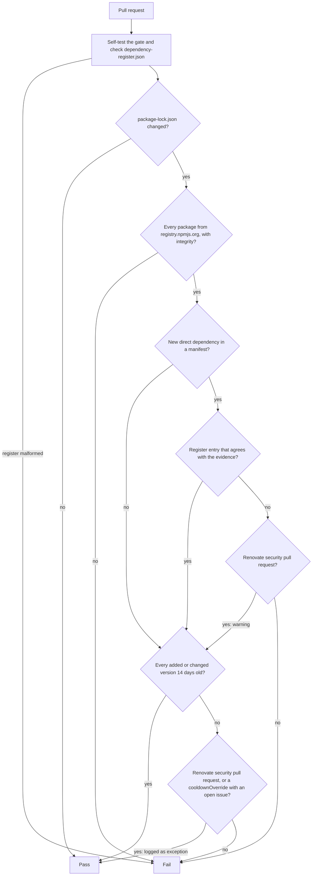
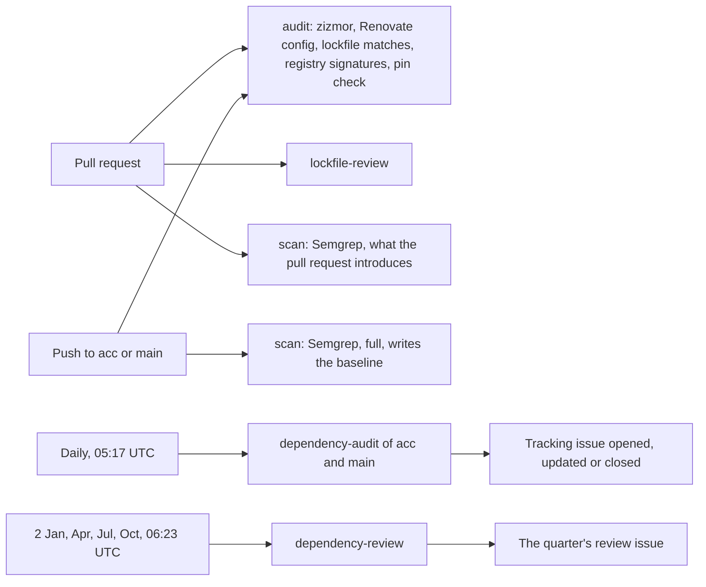

# Dependencies

Pinning fixes what is installed; this page is about what is allowed in, and what is noticed after it is in. A
pull request that changes `package-lock.json` is reviewed as data: where each package comes from, whether a new
direct dependency has a written assessment, and whether every changed version is at least 14 days old. After the
merge, a daily audit looks for advisories on `acc` and `main`, Semgrep scans every change, and a quarterly review
looks for abandoned packages.

How the pins themselves are set and kept current is on [Pinning](supply-chain.md).

## How a lockfile change is reviewed

The `lockfile-review` job (in `.github/workflows/zizmor.yml`) runs on every pull request, whatever its base or
paths, so it can be a required check without ever failing to report.

1. **Self-test.** The job runs the tests of `scripts/lockfile-diff.mjs` and `scripts/dependency-gate.mjs`, then
   `dependency-gate.mjs --check-register`, before it looks at the lockfile: a broken register fails every pull
   request, not only the next one that changes dependencies.
2. **Unchanged lockfile.** The job passes at once.
3. **The lockfile diff.** `lockfile-diff.mjs` compares the base and head lockfiles as data. It **fails** on any
   package resolved from somewhere other than `https://registry.npmjs.org/`, or recorded without an integrity hash.
   It **prompts** without failing on a licence change, a new package whose licence is not on the allow-list in
   `lockfile-review.json`, a new install script, and a downgrade.
4. **The dependency gate.** `dependency-gate.mjs` runs whatever the diff found, and checks new direct dependencies
   and the cooldown (below).
5. **One report.** Both write to the job summary, and a second job, `lockfile-review-comment`, posts or updates a
   single comment on the pull request. The first job holds a read-only token; the comment job holds
   `pull-requests: write` and runs no repository code.

Exit 2 from either script means it could not run (unreadable lockfile, registry or GitHub API unreachable) and
fails the check: it never reads as clean.

### A new direct dependency needs a register entry

"New" means new to that manifest, under any of `dependencies`, `devDependencies`, `optionalDependencies` or
`peerDependencies`: a package already direct in one workspace still counts when it is added to another. Each one
needs an entry in `dependency-register.json` in the same pull request. The register holds only what has been
added through the gate; it is not a list of every dependency.

| Field | Content |
|---|---|
| `name`, `manifest`, `field` | the package, the manifest (`(root)` or `packages/<name>`), the field |
| `status` | `assessed`, or `override` for an urgent fix with no time to assess |
| `assessed.version` | the version assessed; its major must equal the locked major |
| `criteria` | the six criteria, each `holds: true/false` with a `why` |
| `outcome` | `keep`, or `replace` with a `followUp` issue |
| `override` | `{ reason, issue }`: the issue is the assessment still owed |

The six criteria are those of Linked Data Explorer's `docs/dependency-criteria.md`: **maintained**, **maintainers**,
**licence**, **release policy**, **footprint**, **needed**. The gate gathers the evidence itself from the npm
registry, the GitHub API and the lockfile, and blocks when:

- the entry is missing (a Renovate security pull request passes with a warning instead);
- an entry says a criterion holds that the evidence contradicts: no release in 12 months, deprecated, or an
  archived or unchecked repository (maintained); one npm maintainer and no organisation (maintainers); a licence
  not on the allow-list (licence); an install script anywhere in what it pulls in (footprint);
- `needed`, or any criterion that does not hold, has a `why` shorter than 40 characters, or two `why`s are identical;
- the assessed major is not the locked major;
- a cited `followUp` or `override` issue is not an open issue (a pull request does not count);
- the package is deprecated or archived, unless the outcome is `replace` with an open follow-up.

An `override` entry passes when its issue is open, and is listed as a warning.

### The cooldown on lockfile versions

`npm ci` installs the lockfile without applying `.npmrc`'s `min-release-age`, so the gate checks the lockfile
itself: every package version from the registry that the pull request adds or changes, direct or transitive, must
have been published at least `minReleaseAgeDays` (14, in `lockfile-review.json`) before the run. A version with no
publish time fails. Two exceptions, both written into the comment's *Cooldown exceptions* section:

- **A Renovate security update.** All three must hold: the author is `renovate[bot]`, the pull request carries the
  `security` label, and the GitHub API's event history shows `renovate[bot]` adding it. The gate asks the API when
  it runs and waits up to 60 seconds for Renovate's labels. A person adding the label does not count.
- **A committed override.** An entry in the register's `cooldownOverrides`: `{ package, version, reason, issue }`,
  with an open issue.

There is no label a person can set and no bypass.

**The daily proof (RONL Business API).** The `Cooldown proof` step of `dependency-audit.yml` runs
`scripts/cooldown-proof.mjs`: it picks a version of a frequently published package (`@types/node` first) younger
than the cooldown and asks npm to install it with the repository's `.npmrc`. It passes only if npm refuses, and the
same command with `--min-release-age=0` succeeds. A failure reaches the daily audit's tracking issue.

## When the scans run

**Audits.** `dependency-audit.yml` checks out `acc` and `main` in turn and audits each branch's lockfile; it
installs nothing. A run that cannot audit exits 2 and counts as a finding. It opens one tracking issue, updates it
while the finding stands, and closes it when the audit is clean. It also runs on a pull request that changes the
audit itself, without touching the issue.

| Component | Tool | Fails on | Reported only |
|---|---|---|---|
| CPSV Editor, Linked Data Explorer, RONL Business API | `npm audit --package-lock-only`, grouped per advisory by `scripts/audit-tree.mjs` | a high or critical advisory in production dependencies | moderate and low; everything dev-only |
| CPRMV | `pip-audit==2.10.1` via `scripts/audit-requirements.sh` | any advisory in `serve_api/requirements.txt` (pip-audit grades no severity) | advisories only in `requirements-dev.txt` |

CPRMV passes accepted advisory IDs from `scripts/pip-audit-accepted.txt` as `--ignore-vuln`; each needs a row in
the accepted-findings table of its `SECURITY-PIPELINE.md`. The file lists none.

**Registry signatures.** In the three applications the `audit` job runs `npm run audit:signatures`
(`scripts/audit-signatures.sh`) after `npm ci`: it checks the registry signature of every installed package and the
provenance attestation of those that have one, and fails on an invalid or missing signature or an advertised
attestation that cannot be fetched. A package without an attestation passes. CPRMV relies on the hashes instead.

**Semgrep.** The `scan` job (`.github/workflows/semgrep.yml`) runs `semgrep ci --no-suppress-errors` with
`SEMGREP_APP_TOKEN`: Semgrep Code and Supply Chain. On a pull request it reports what the pull request introduces;
the pushes to `acc` and `main` write the baseline in Semgrep Cloud. It fails on findings the Semgrep Cloud policy
marks blocking, and when the tool itself errors. `.semgrepignore` excludes tests and examples (CPRMV: `docs/`,
generated ReSpec output and test fixtures). A pull request from a fork gets no secret, so `scan` fails for it; the
repositories have no forks.

**Triage.** A Code finding that is a false positive is suppressed in the code: a comment with the reason, then
`nosemgrep: <full rule id>` on the line above. A Supply Chain finding, or a true positive accepted rather than
fixed, is triaged in the Semgrep UI with a comment, and the reason is also written as a row in the
`SECURITY-PIPELINE.md` table, because the platform's API does not return UI comments.

**Quarterly review.** `dependency-review.yml` runs `scripts/dependency-review.mjs` over every direct dependency in
`package-lock.json`, asks the npm registry and the GitHub API for the same signals the gate uses, and opens an
issue titled *Quarterly dependency review — YYYY-Qn*: *Failing* (deprecated, archived, or no evidence), *To judge*,
*Register: still open* (overrides, replacements, cooldown overrides), the previous quarter's Renovate security
exceptions, and all direct dependencies. The run never fails; the outcomes are recorded in the issue. A re-run in
the same quarter adds a comment.

## Per repository

| Component | `lockfile-review` | Register entries | Daily audit (issue labels) | Cooldown proof | Quarterly review | `scan` | Accepted-findings table |
|---|---|---|---|---|---|---|---|
| CPSV Editor | required on `acc` | 1 | npm (`security`, `ci`) | not in place | yes | required on `acc` and `main` | not in place |
| Linked Data Explorer | required on `acc` | 5 | npm (`dependencies`, `security`) | not in place | yes | required on `acc` and `main` | not in place |
| RONL Business API | required on `acc` | 3 | npm (`dependencies`, `security`) | daily | yes | required on `acc` and `main` | *Semgrep findings we accept, and why* |
| CPRMV | not in place (no npm lockfile in CI; the `audit` job checks requirement drift and hashes) | — | pip-audit (`security`, `ci`) | not in place | not in place | required on `acc` and `main` | *Findings we accept, and why* |
| Norm Editor | not in place | — | not in place | not in place | not in place | not in place | — |

The scripts `lockfile-diff.mjs`, `dependency-gate.mjs` and `dependency-review.mjs` are the same in the three
applications (formatting aside). The Norm Editor's GitLab pipeline runs tests and image builds only: no audit, no
lockfile review, no Semgrep.

## What it does not cover

- **The gate trusts its own pull request.** The job runs the pull request's copy of the gate, and the rulesets
  require no approvals, so a pull request can weaken the gate by editing it. The change shows in the diff.
- **`"inBundle": true`.** A lockfile entry marked as bundled is skipped by the origin, integrity and cooldown checks.
- **A green pull request on a stale base.** The checks run on the merge commit with the base as it is then. Two
  dependency pull requests that each pass can still combine into a lockfile that matches no `package.json`; merge
  them one at a time, rebasing each onto the merged `acc`.
- **`main` does not require `lockfile-review`.** It changes only by promotion of commits that passed it on `acc`.
- **Judgement.** The gate checks that an entry is consistent with the evidence and written out; whether the
  reasoning is sound is the reviewer's.
- **Dependencies already in the tree.** The gate assesses only what a pull request adds; the quarterly review covers the rest.
- **CPRMV**: no cooldown check on a requirements change, no quarterly review. **Norm Editor**: none of this page.

## Where it lives

| What | Path |
|---|---|
| Lockfile review and gate (job `lockfile-review`) | `.github/workflows/zizmor.yml` |
| Lockfile diff | `scripts/lockfile-diff.mjs`; licence allow-list and `minReleaseAgeDays` in `lockfile-review.json` |
| Dependency gate | `scripts/dependency-gate.mjs` (rules in its header comment) |
| Register | `dependency-register.json` (`dependencies`, `cooldownOverrides`) |
| Criteria | Linked Data Explorer `docs/dependency-criteria.md` |
| Daily audit | `.github/workflows/dependency-audit.yml`; `scripts/audit-tree.mjs`; CPRMV `scripts/audit-requirements.sh`, `scripts/pip-audit-accepted.txt` |
| Cooldown proof | RONL Business API `scripts/cooldown-proof.mjs` |
| Registry signatures | `scripts/audit-signatures.sh` (`npm run audit:signatures`) |
| Semgrep | `.github/workflows/semgrep.yml`, `.semgrepignore` |
| Quarterly review | `.github/workflows/dependency-review.yml`, `scripts/dependency-review.mjs` |
| Accepted findings | `SECURITY-PIPELINE.md` in each repository |
| Required checks | the rulesets; see [Branches & Promotion](branch-protection.md) |
