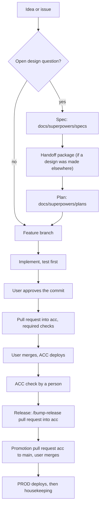

# Development Workflow

This page follows one piece of work from idea to production in these repositories. Work is designed and planned in
the repository, implemented on a feature branch, merged into `acc` through a pull request whose checks must pass,
checked on acceptance by a person, and promoted to `main` through a second pull request. The assistant prepares each
step; the user approves every commit, merge and promotion.

## How it works

1. **Design.** Work with an open design question starts as a written spec. Small, well-understood changes skip
   straight to the feature branch.
2. **Handoff.** When a design was produced outside the repository, it arrives as a handoff package (below).
3. **Plan.** Multi-step work gets a written plan before any code. Specs and plans live in the repository, next to the
   code they describe.
4. **Implement.** On a feature branch in the main checkout, never on `acc` or `main`. Tests come first: write the
   failing test, watch it fail, then write the code that makes it pass.
5. **Pull request into `acc`.** The `acc` ruleset requires a pull request and a set of passing checks, with no bypass;
   see [Branches & Promotion](../branch-protection.md). The checks behind it are on
   [Dependencies](../dependency-scanning.md), [Tests & Coverage Gates](../coverage-floor.md) and
   [Code Standards & Hooks](../code-standards.md).
6. **ACC check.** Merging deploys acceptance. A person looks at the change there before it goes further.
7. **Release and promotion.** `/bump-release` cuts a release as its own pull request into `acc`; a promotion pull
   request from `acc` to `main` takes it to production. Both are merged by the user.
8. **Housekeeping.** After the merges: sync the local branches, delete the merged branch, check the install against
   the lockfile. The steps are listed on [Working with Claude Code](working-with-claude-code.md#git).

## Specs and plans

| Component | Specs | Plans | Release command |
|---|---|---|---|
| CPSV Editor | `docs/superpowers/specs/` | `docs/superpowers/plans/` | `.claude/commands/bump-release.md` |
| Linked Data Explorer | `docs/superpowers/specs/` | `docs/superpowers/plans/` | `.claude/commands/bump-release.md` |
| RONL Business API | `docs/superpowers/specs/` | `docs/superpowers/plans/` | `.claude/commands/bump-release.md` |
| CPRMV | `docs/superpowers/specs/` | `docs/superpowers/plans/` | `.claude/commands/bump-release.md` |
| Norm Editor | not in place | not in place | not in place |

Specs are named `YYYY-MM-DD-<topic>-design.md` and plans `YYYY-MM-DD-<feature>.md`, and both are committed. The `superpowers` plugin's brainstorming and planning skills
write them; see [Working with Claude Code](working-with-claude-code.md#plugins).

## The handoff package

A handoff package is a folder dropped into a repository as `docs/<feature>-handoff/`. It holds a ready-to-use prompt,
architecture or design notes, and a `reference/` folder with the design's own source files; it often carries
standalone HTML and screenshots of the design as well.

- **Its files are the single source of truth** for that piece of work, not a same-named or similar-looking file
  already in the application.
- **The folder is never committed.** What it specifies is ported into the real source files; the folder stays
  untracked, or is removed with `git rm` before the final commit.

| Component | Handoff folders in the tree | Format check skips them |
|---|---|---|
| CPSV Editor | none | not in place |
| Linked Data Explorer | none | not in place |
| RONL Business API | one: `docs/pa-demo-social-handoff/` is tracked | yes: `.prettierignore` lists `*-handoff/` |
| CPRMV | none | not applicable (no Prettier) |
| Norm Editor | none | not in place |

The tracked folder in the RONL Business API is the one exception to the rule; it is not a model to follow.

## Who decides what

| Step | The assistant | The user |
|---|---|---|
| Spec and plan | drafts them | approves the design before planning |
| Branch and implementation | creates the branch, writes code and tests | reviews |
| Commit | stages the work and reports what is staged | approves every commit |
| Push and pull request | pushes the branch, opens the pull request | approves pushes that deploy a shared branch |
| Merge into `acc` | waits for the checks | merges |
| ACC check | asks | looks at the change on acceptance |
| Release and promotion | runs `/bump-release`, opens the pull requests | merges both |
| Housekeeping | runs it when asked, reports a stale install | runs `npm ci` and restarts dev servers |

Approval is per step and never carries over: an earlier "commit this" does not cover the next commit. The full set of
boundaries is on [Working with Claude Code](working-with-claude-code.md#working-boundaries).

## This documentation site

The site follows the same path with two differences. It has no rulesets, and acceptance is a separate host: pushing
`acc` to the `flevoland` remote (Azure DevOps) deploys the acceptance site through the root
`azure-static-web-apps-pipeline.yml`, and that push is where the user checks the change. After the check, `acc` goes
to GitHub and a promotion pull request into `main` deploys production through
`.github/workflows/azure-static-web-apps-lively-water-0b8f0c003.yml`. The site cuts no releases. Keeping it in step
with the components is the job of `/iou-document-patch`; see
[Working with Claude Code](working-with-claude-code.md#project-commands-and-skills).

## What it does not cover

- The Norm Editor keeps no specs, plans or project commands in its repository; its own release process is not
  described here.
- No check verifies that a spec or plan exists before implementation starts. The workflow relies on the assistant and
  the user following it.
- Tests-first is a working practice, not a gate: CI checks that tests pass and meet the coverage floor, not the order
  in which they were written.

## Where it lives

| What | Where |
|---|---|
| Specs and plans | `docs/superpowers/specs/`, `docs/superpowers/plans/` in each repository |
| Release command | `.claude/commands/bump-release.md` in each repository that has one |
| Rulesets on `acc` and `main` | GitHub repository settings, *Rules*; see [Branches & Promotion](../branch-protection.md) |
| Handoff ignore | `.prettierignore` in the RONL Business API |
| Working rules | `~/.claude/CLAUDE.md`; see [Working with Claude Code](working-with-claude-code.md) |
