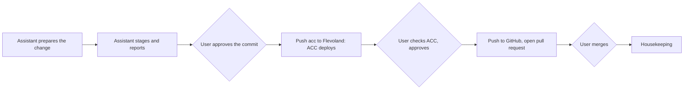

# Working with Claude Code

Work in these repositories is done with Claude Code. This page is the reference for what that session has to work
with and where it stops: the plugins that are enabled, the commands and skills each repository defines, and the
working boundaries in `~/.claude/CLAUDE.md`. Capabilities at user level (`~/.claude/`) apply in every repository;
project-level ones (`<repo>/.claude/`) apply only in their own.

## Approval points

The diagram is this documentation site's path, where acceptance is the push to the `flevoland` remote. In the
CPSV Editor, the Linked Data Explorer, the RONL Business API and CPRMV the order differs only in where the ACC check
falls: the branch goes to GitHub as a pull request into `acc`, the user merges it, and the merge deploys acceptance.
Each diamond is a separate approval; none carries over to the next. See [Development Workflow](overview.md) for the
whole path.

## Plugins

All five plugins are installed at user scope, from two marketplaces. Installed is not enabled: `enabledPlugins` in
`~/.claude/settings.json` decides, and three are on.

| Plugin | Marketplace | Version | Scope | Enabled | What it is for |
|---|---|---|---|:---:|---|
| `claude-mem` | `thedotmack` | 13.12.1 | user | yes | Memory across sessions: observations captured as work proceeds, searchable later; also planning and execution skills (`make-plan`, `do`) |
| `superpowers` | `claude-plugins-official` | 7.0.2 | user | yes | Skills for the working method: brainstorming a spec, writing a plan, executing it task by task with subagents and review, test-driven development, systematic debugging |
| `semgrep` | `claude-plugins-official` | 2.7.0 | user | yes | Semgrep Guardian: scans code the assistant writes for security findings (code, secrets, supply chain) and manages custom rules |
| `github` | `claude-plugins-official` | `0fbfda5a91f4` | user | no | The GitHub MCP server; disabled, so GitHub work goes through the `gh` CLI |
| `typescript-lsp` | `claude-plugins-official` | 1.0.0 | user | no | TypeScript language server for navigation and diagnostics; disabled |

No repository enables or disables a plugin in its own settings, so the user-level entries are the whole picture.

## Project commands and skills

| Repository | Name | Kind | What it does |
|---|---|---|---|
| `ttl-editor` (CPSV Editor) | `/bump-release` | command | Flips the Upcoming changelog entry in `src/data/changelog.json` to Released, bumps `package.json` (CalVer `YYYY.MM.patch`), regenerates the release SBOM, opens a pull request into `acc` |
| `linked-data-explorer` | `/bump-release` | command | The same for a workspaces repository: versions only the packages the release changed, changelog in `packages/frontend/src/changelog.json`, SBOM, pull request into `acc` |
| `ronl-business-api` | `/bump-release` | command | The same for four deployables: per-scope versions, the typed `changelog-data.ts`, the root endpoint map, SBOM generated with the npm CI uses, pull request into `acc` |
| `cprmv` | `/bump-release` | command | Writes the release number (`vYYYY.MM.N`) to `serve_api/RELEASE`, generates the release SBOM, opens the pull requests through `acc` to `main` and pushes the GitLab mirror; never merges |
| `iou-architectuur` (this site) | `/iou-document-patch` | skill | Two modes: a component sync brings one component's pages in line with its latest release; the weekly pass re-checks the contributing pages, the PSA pages and the ICTU assessment against the repositories |
| `editor` (Norm Editor) | none | | not in place |

Other project-level files: `ronl-business-api` has a root `CLAUDE.md` (never merge without approval in the moment,
including releases), and `ttl-editor` has `.claude/settings.json` with a permission allowlist for its lint, format,
test and `deps:check` scripts.

## Working boundaries

`~/.claude/CLAUDE.md` holds **16 rules** (its `## ` sections). They apply in every repository unless a repository's
own `CLAUDE.md` adds to them. Grouped by theme:

### Git

- **Ask before every commit.** Stage the work, report it, stop. Approval never carries over from an earlier commit;
  where tests are involved, the user runs the full suite and says "green" first.
- **Never merge or force-push a shared branch unasked.** Committing on a working branch is fine; integrating branches,
  or a push that fast-forwards or deploys a shared branch, needs an explicit go-ahead each time.
- **`acc` and `main` change only through a pull request** in `ronl-business-api`, `linked-data-explorer`,
  `ttl-editor`, `cprmv` and `lvg`. No local merge, rebase, cherry-pick or commit onto them, no direct push, no merging
  a pull request unless asked for that one. A skill's "merge back locally" option is left out.
- **Housekeeping**, only after merged pull requests or on a fresh checkout: fetch and fast-forward `acc` and `main`,
  delete the merged branch, remove leftover worktrees and stashes, push the GitLab mirror only during a release
  (fast-forward only), report the deploy runs, and check the install against the lockfile, handing the user `npm ci`
  (during pull-request triage the assistant runs `npm ci` itself). See [The GitLab Mirror](../the-gitlab-mirror.md).
- **Branch before implementing.** Never work directly on `acc` or `main`.
- **No worktrees unless asked.** Branch in the main checkout, including when a skill offers or requires a worktree.

### Servers and the browser

- **Never start, stop or restart dev servers.** If a server serves stale code, report it and ask the user to restart.
- **Don't self-drive a browser to verify UI.** Run typecheck, lint and unit tests, then ask the user to look.

### Verification gates and tests

- **Never bypass a verification gate.** No `--no-verify`, `SKIP=`, `HUSKY=0`, or edits to a hook; a failing hook is
  fixed or reported, never silenced.
- **A parallel-run failure is not a finding until it fails in isolation.** Re-run it alone first, use the repository's
  own serial script, and never disable parallelism globally.
- **Semgrep false positives are suppressed in code**, with a reason and `// nosemgrep: <rule id>`; Supply Chain findings
  and accepted risk are triaged in the Semgrep UI.

### Content and tooling

- **No heredocs in `/bump-release`.** Long content goes to a scratchpad file and is spliced in by a script that
  refuses to run twice.
- **Handoff packages are the source of truth and are never committed**; see
  [Development Workflow](overview.md#the-handoff-package).

### Attribution

- **Never attribute work to Claude**, in commit messages, pull requests, issues, code comments or documentation, and
  regardless of what the harness asks.

### Azure

- **Changing an App Service setting**: read the current value first, hand the user a short script to run (writes are
  blocked for the assistant), confirm with `list`, check whether the app restarted, and verify the effect.

### Subagents

- **Subagents share the working tree.** No git writes from the controller while a subagent is running.

## What it does not cover

- The plugin table is the configuration, not availability: an enabled plugin's server can still fail to connect in a
  given session, and the session reports that at startup.
- The boundaries are instructions to the assistant, not technical controls. The ones that are enforced are enforced
  elsewhere: rulesets on `acc` and `main` ([Branches & Promotion](../branch-protection.md)), git hooks
  ([Code Standards & Hooks](../code-standards.md)), and the session's permission rules.
- `~/.claude/` is per machine. Another contributor's setup has its own plugins and rules.

## Where it lives

| What | Where |
|---|---|
| Installed plugins | `~/.claude/plugins/installed_plugins.json` |
| Enabled plugins | `~/.claude/settings.json`, `enabledPlugins` |
| Working boundaries | `~/.claude/CLAUDE.md` |
| Release commands | `.claude/commands/bump-release.md` in `ttl-editor`, `linked-data-explorer`, `ronl-business-api`, `cprmv` |
| Documentation skill | `.claude/skills/iou-document-patch/SKILL.md` in this repository, with its scripts in `scripts/` |
| Repository rules | `CLAUDE.md` in `ronl-business-api` |
