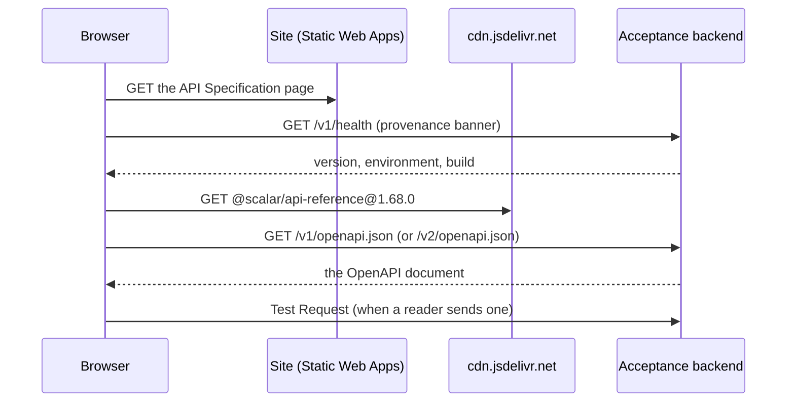

# OpenAPI Rendering

Three pages turn a component's OpenAPI document into a browsable reference: the Linked Data Explorer's
[API Specification (v1)](../../linked-data-explorer/reference/api-specification.md) and
[API Specification (v2)](../../linked-data-explorer/reference/api-specification-v2.md), and the
[RONL Business API's API Specification](../../ronl-business-api/reference/api-specification.md). Each renders the
document in the browser with Scalar, fetched live from the component's acceptance backend; nothing is stored in this
repository. This page explains how they are wired and what they depend on at run time.

## How it works

Each page contains, in order:

1. **A banner element** — `#lde-spec-provenance` on the two Linked Data Explorer pages, `#rba-spec-provenance` with
   class `.spec-provenance` on the RONL Business API page — hidden until filled.
2. **An inline script** that fetches the backend's `/v1/health` and writes
   `Rendered from <environment> · version <x> · build <sha> · #<run> · read <time> UTC` into the banner. If the
   fetch fails the banner stays hidden; the reference still renders.
3. **A configuration element** `<script id="api-reference" data-url="…" data-configuration='…'>` naming the document
   to fetch.
4. **Scalar** itself, `https://cdn.jsdelivr.net/npm/@scalar/api-reference@1.68.0/dist/browser/standalone.js`.

The document's `info.version` is the release version, set from the backend's `package.json` at build time. The
banner adds what the document cannot say: which environment and which build served it.

## Per page

| Page | Document | Banner reads | `/v1/health` shape | Security schemes in the document |
|---|---|---|---|---|
| LDE v1 | `https://acc.backend.linkeddata.open-regels.nl/v1/openapi.json` | LDE `/v1/health` | flat, with a preformatted `build.label` | `bearerAuth`, on the state-changing operations; no global `security` |
| LDE v2 | `https://acc.backend.linkeddata.open-regels.nl/v2/openapi.json` | LDE `/v1/health` (same process) | as above | none |
| RONL Business API | `https://acc.api.open-regels.nl/v1/openapi.json` | RBA `/v1/health` | wrapped in `{ success, data }`; the script formats `data.build.sha` and `run` | `bearerAuth` (global), `mediaAggregatorKey`, `m2mOAuth` |

All three use the same Scalar configuration:

- `"layout": "classic"` — Scalar's default `modern` layout fixes its sidebar and search to the viewport, which
  escapes Material's content column. `classic` keeps the sidebar inline.
- `"servers"` overridden to the acceptance base URL only (`…/v1` or `…/v2`). The documents list Production first;
  the override keeps **Test Request** off production.
- `"withDefaultFonts": false`, `"showSidebar": true`, `"hideDownloadButton": false`.

The banners are styled by `docs/stylesheets/spec-provenance.css`.

## What it depends on at run time

| Mechanism | Governs | Needed for |
|---|---|---|
| `Access-Control-Allow-Origin: *` on `/v1/openapi.json` and `/v2/openapi.json` | the document fetch | the render, from any origin |
| The backend's `CORS_ORIGIN` allowlist | every other route | the banner and **Test Request** |
| `cdn.jsdelivr.net` reachable | the Scalar script | the render |

Measured with an `Origin` header, on `GET /v1/health`:

| `Origin` sent | LDE acceptance | RBA acceptance | LDE and RBA production |
|---|---|---|---|
| `https://iou-architectuur.open-regels.nl` | echoed | echoed | absent |
| `https://acc.iou-architectuur.open-regels.nl` | echoed | echoed | — |
| `http://localhost:8000` | absent | absent | — |

So the banner and Test Request work on both deployed documentation tiers, and not under `mkdocs serve`. No
documentation page can call a production backend from the browser. Test Request against a secured operation needs
a token: a Keycloak access token for `bearerAuth`.

### The Content-Security-Policy is not applied

`staticwebapp.config.json` at the repository root declares a Content-Security-Policy, `X-Frame-Options: DENY` and
other headers. It is not deployed: both pipelines publish `app_location: site`, and `mkdocs build` copies only
`docs/staticwebapp.config.json` (`trailingSlash: auto`) into `site/`. Neither deployed tier sends a
`Content-Security-Policy` or `X-Frame-Options` header. Tracked in
[iou-architectuur#98](https://github.com/sgort/iou-architectuur/issues/98).

The render and Test Request therefore work because no policy is enforced. If the root file's policy were applied
as written:

- `connect-src` already names both acceptance backends, so the document fetch, the banner and Test Request would
  keep working; removing a backend from it would blank its page.
- `script-src` admits `cdn.jsdelivr.net`, so Scalar would load. It does not admit `unpkg.com`, where Material loads
  Mermaid from, so diagrams across the site would stop rendering.
- `style-src` admits `'self'`, `'unsafe-inline'` and `https://fonts.googleapis.com` only, so a renderer that loads
  its own stylesheet from a CDN would need it vendored.
- `X-Frame-Options: DENY` would block iframe-based renderers such as `mkdocs-swagger-ui-tag` and `mkdocs-redoc-tag`.

## What it does not cover

- **Site search.** Scalar renders in the browser, so operations and schemas are not in the MkDocs search index;
  only each page's own prose is.
- **Reproducibility.** The page shows what the acceptance backend serves now. It cannot show an earlier version,
  and renders nothing when the backend is unreachable.
- **Production.** Every page points at acceptance; the production documents are not rendered here.
- **Other components.** No OpenAPI document of CPRMV, the CPSV Editor or the Norm Editor is rendered on this site.

## Where it lives

| What | Path |
|---|---|
| The three pages | `docs/en/linked-data-explorer/reference/api-specification.md`, `api-specification-v2.md`, `docs/en/ronl-business-api/reference/api-specification.md` |
| Banner styles | `docs/stylesheets/spec-provenance.css` (in `extra_css`) |
| Scalar version | the `<script src>` at the end of each page |
| Document URL and servers override | the `data-url` and `data-configuration` attributes on `#api-reference` |
| Header file that is not deployed | `staticwebapp.config.json` (repository root) |
| Header file that is deployed | `docs/staticwebapp.config.json` |
| CORS allowlists | each backend's `CORS_ORIGIN` App Service setting |
