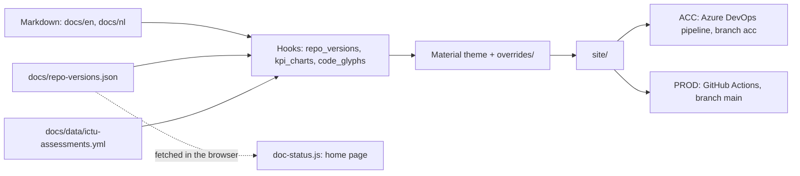
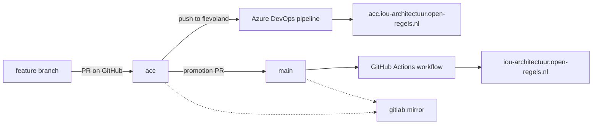
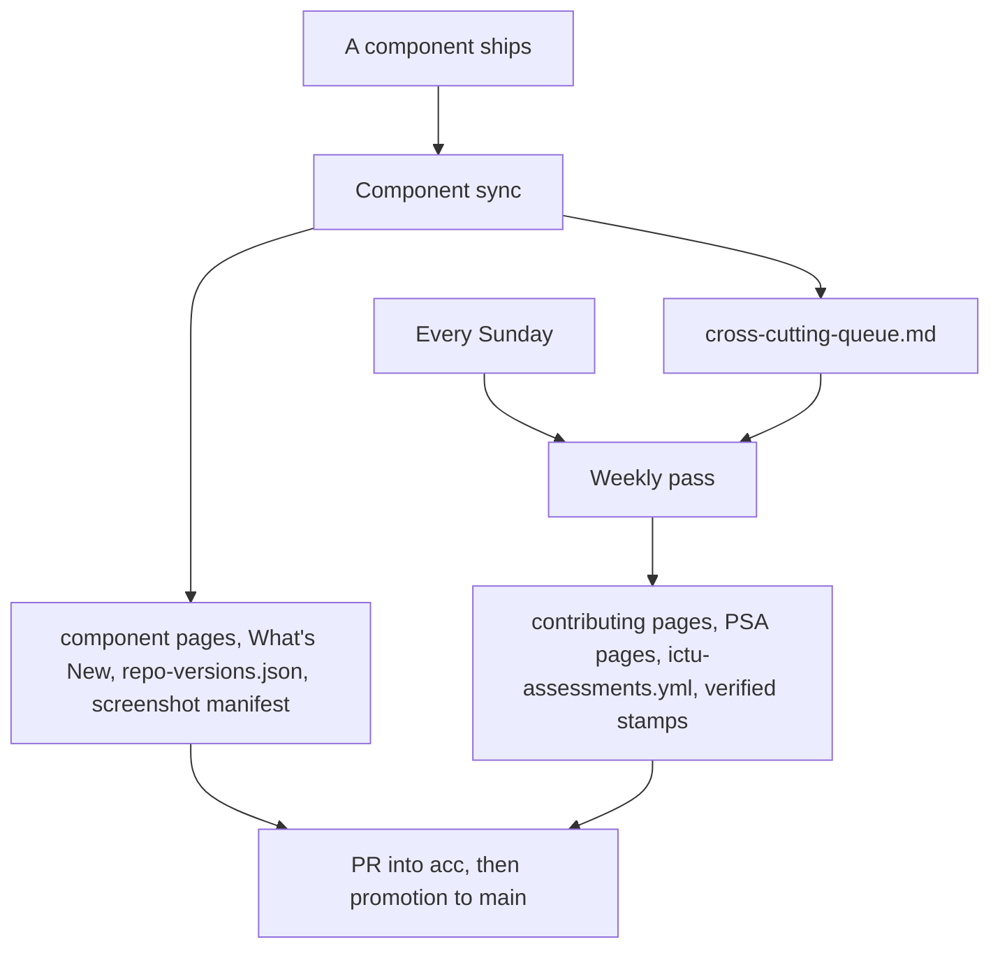

# Documentation Architecture

This site is a MkDocs build of this repository (`sgort/iou-architectuur`). Markdown under `docs/en/` and `docs/nl/`,
two data files and three build hooks go in; Material for MkDocs renders them into a static site; Azure Static Web
Apps serves it, acceptance from `acc` and production from `main`. This page covers the stack, the layout of the
source tree, the metadata header every page carries, how the site is built and deployed, and how its content is
kept in step with the components.

## How a build works



1. `mkdocs build` reads `mkdocs.yml`. The i18n plugin builds the site twice, once per language folder.
2. On `on_config`, `hooks/repo_versions.py` loads `docs/repo-versions.json` into `config.extra.repo_versions`, and
   `hooks/kpi_charts.py` loads `docs/data/ictu-assessments.yml`.
3. On `on_page_markdown`, `kpi_charts.py` replaces placeholders with generated tables and SVG charts, and
   `code_glyphs.py` checks box-drawing diagrams against the code font.
4. Material renders each page through `overrides/main.html`, which puts the metadata header at the top.
5. The output in `site/` is uploaded to Azure Static Web Apps; `repo-versions.json` is copied along and read again
   in the browser by `doc-status.js`.

## Stack

| Part | What is used | Version |
|---|---|---|
| Generator | `mkdocs` | `>=1.5.3` in `requirements.txt` |
| Theme | `mkdocs-material`, `custom_dir: overrides` | `>=9.5.0` |
| Languages | `mkdocs-static-i18n` | `>=1.2.0` |
| Page dates | `mkdocs-git-revision-date-localized-plugin` (`type: timeago`, creation date on) | `>=1.2.0` |
| Markdown extensions | `pymdown-extensions` | `>=10.7` |
| Pinned exactly | `click` | `==8.2.1` |
| Python in CI | both pipelines | `3.11` |

Only `click` is pinned; every other package is a lower bound, so each CI run installs the newest matching release.
`requirements-dev.txt` holds `pypandoc_binary`, used by the PSA template tooling and not needed to build.

**Plugins** (in `mkdocs.yml`): `search` (English and Dutch), `i18n` (see [Languages](#languages)) and
`git-revision-date-localized`.

**Markdown extensions that shape the pages**:

| Extension | Used for |
|---|---|
| `pymdownx.superfences` with a `mermaid` custom fence | Mermaid diagrams; Material loads Mermaid 11 from `unpkg.com` in the browser |
| `admonition`, `pymdownx.details` | `!!!` call-outs and collapsible `???` blocks |
| `pymdownx.tabbed` (alternate style) | content tabs |
| `attr_list`, `md_in_html` | grid cards (the What's New cards), classes on elements |
| `pymdownx.snippets` with `auto_append` | `includes/abbreviations.md` is appended to every page, so `abbr` tooltips work site-wide |
| `pymdownx.highlight`, `inlinehilite` | code highlighting |
| `toc` (`permalink`, depth 3) | heading anchors |
| `pymdownx.arithmatex`, `emoji`, `tasklist`, `keys`, `mark`, `caret`, `tilde`, `betterem`, `smartsymbols`, `abbr`, `def_list`, `footnotes`, `tables` | inline formatting |

**Hooks** (`hooks/`, listed under `hooks:` in `mkdocs.yml`):

| Hook | What it does | When it fails |
|---|---|---|
| `repo_versions.py` | Loads `docs/repo-versions.json` into `config.extra` for the metadata header; derives `commit_base` per component from `ci_repo` (GitHub `/commit/`, GitLab `/-/commit/`) | Header falls back to git dates only |
| `kpi_charts.py` | Replaces `<!-- ictu:scores -->`, `totals`, `heatmap`, `movement`, `changes`, `tests`, `testgates` with tables and inline SVG from `docs/data/ictu-assessments.yml`, coloured by `--ictu-*` variables in `extra.css` | Placeholder becomes a "could not be read" admonition |
| `code_glyphs.py` | Warns when a fenced block with box-drawing characters uses a glyph outside `docs/assets/fonts/JetBrainsMono-coverage.txt` | Warning only |

**Theme overrides** (`overrides/`):

- `main.html` overrides the `content` block: on a page with `component:` or `scope: cross-cutting` it renders
  `partials/doc-meta.html` first and drops the bottom date aside, so the dates move instead of appearing twice. It
  also adds the Open Graph and Twitter card image. It mirrors Material's `partials/content.html` by hand, so a
  Material upgrade that changes that file needs a re-check.
- `partials/doc-meta.html` is the metadata header (see [below](#the-page-metadata-header)).

**Browser scripts and styles** (`extra_javascript`, `extra_css`):

| File | Does |
|---|---|
| `javascripts/doc-status.js` | Fetches `repo-versions.json` and fills three home-page elements: `#last-patch` (the last documentation patch, the one before it, open findings), `#doc-status` (the status table: component, version, vocabulary, environment, commit, commit date) and the ACC/PROD badge on each `.whats-new-cards` card whose title contains the component name. Re-runs on Material's instant navigation |
| `javascripts/language-switch.js` | Stops Material intercepting the language selector, so its page-level links work |
| `stylesheets/extra.css` | Palette, tables, badges, the metadata header, the ICTU charts |
| `stylesheets/spec-provenance.css` | The provenance banner on the API Specification pages (see [OpenAPI Rendering](openapi-rendering.md)) |
| `stylesheets/code-font.css` | JetBrains Mono, served from `docs/assets/fonts/`, so box-drawing diagrams line up |

## Structure and navigation

The nav in `mkdocs.yml` has eight top-level tabs:

| Tab | Folder |
|---|---|
| Home | `index.md` |
| 🧭 Project Start Architecture | `psa/` |
| ⚙️ RONL Business API | `ronl-business-api/` |
| 🖍️ Norm Editor | `norm-editor/` |
| ✏️ CPSV Editor | `cpsv-editor/` |
| 🔍 Linked Data Explorer | `linked-data-explorer/` |
| 📜 CPRMV API | `cprmv-api/` |
| 🤝 Contributing | `contributing/` |

Each component folder has the same four sub-folders, which are the four sections of its tab:

| Folder | Nav section | Holds |
|---|---|---|
| `features/` | Features | what the component does |
| `user-guide/` | User Guides | task-oriented guides |
| `developer/` | Developer Docs | architecture, testing, deployment, changelog |
| `reference/` | References | API specification, data models, vocabularies |

A path segment named `archive` marks a page that describes an older release on purpose; the metadata header shows
no version there.

**Pages outside the nav** are listed under `not_in_nav`: `includes/abbreviations.md` (the snippet source), the
deck pages, and the Dutch-only `nl/contributing/documentation-guide.md`.

**Assets** under `docs/assets/`:

| Folder | Holds |
|---|---|
| `screenshots/` | application screenshots, named `<component>-<subject>.png` |
| `slides/<deck>/` | deck slides as `slide-NN-<slug>.png` |
| `downloads/` | deck PDFs and the PSA template archives |
| `diagrams/` | GraphML diagrams of the SHACL shapes |
| `fonts/` | the vendored code font and its coverage list |

**Operational files outside `docs/`**, versioned with the site but not part of it:

- `screenshot-manifest/<component>-screenshots-todo.md` — screenshots a sync introduced or invalidated, with the
  embedding page and framing, until they are captured.
- `cross-cutting-queue.md` — what a component sync noticed about the contributing pages, waiting for the weekly
  pass.

### Languages

`mkdocs-static-i18n` runs with `docs_structure: folder`: English in `docs/en/`, Dutch in `docs/nl/`. English is the
default and is served at `/`, Dutch at `/nl/`. One nav serves both; its paths carry no language prefix, and
`nav_translations` renames the PSA entries in Dutch. With `fallback_to_default: true`, a page missing from `nl/` is
built from its English source.

Most Dutch pages are placeholders: a "Documentatie in ontwikkeling" admonition linking to the English page, then
`**Status:** Concept`, `**Engelstalige bron:**` with the source path, and the English page's section headings left
empty. The PSA is the exception: it is complete in both languages. A page that exists only in Dutch still needs an
English stub, because nav paths resolve against `en/` first.

## The page metadata header

A page opts in through its front matter; `overrides/partials/doc-meta.html` renders the header directly below the
breadcrumbs. Pages that declare neither key keep Material's dates at the bottom.

| Front matter | Header shows |
|---|---|
| `component: <name>` | created and updated dates; the component's icon, name and `version` with an environment badge; `vocabulary <x>` when recorded; `build <sha> · #<run>` linked to the deploy run when recorded |
| `scope: cross-cutting` | the dates and "Applies to all components" with the `docs built` date |
| `scope: cross-cutting` + `verified:` | the dates, "Applies to all components", then "verified `<date>` against" one linked SHA per component |
| either, on an `archive` path | the dates only |

All values except the git dates come from `docs/repo-versions.json`, keyed on the component's `name` exactly as it
appears there. `build` is a separate fact from `commit`: deploy workflows are path-filtered, so the build serving an
environment can be older than the recorded commit. `vocabulary` is a second version beside the release number
(CPRMV), printed so it can be compared with the service's `/health`.

A `verified` stamp names only the components whose claims on that page were re-checked on that date. Each SHA links
to the commit in that component's `ci_repo`, where its deploy runs are listed:

```yaml
---
scope: cross-cutting
verified:
  date: 2026-11-28
  against:
    CPSV Editor: "4ec37df"
    RONL Business API: "f267d7a"
---
```

The build does not check a stamp for staleness; `.claude/skills/iou-document-patch/scripts/stamp-staleness.py` does,
during a sync. On a Dutch build the header's own words are switched to Dutch by the template.

## Build and deploy



| | Acceptance | Production |
|---|---|---|
| Branch | `acc` | `main` |
| Definition | `azure-static-web-apps-pipeline.yml` (repository root) | `.github/workflows/azure-static-web-apps-lively-water-0b8f0c003.yml` |
| Runs on | Azure DevOps, remote `flevoland` | GitHub Actions, remote `origin` |
| Trigger | push to `acc` (except `pipeline/**`, `.gitattributes`); also declares PRs into `acc` | push to `main`; PRs into `main` build a preview environment, removed when the PR closes |
| Build | `pip install -r requirements.txt`, `mkdocs build -d site` | `pip install -r requirements.txt`, `mkdocs build --verbose` |
| Deploy | `AzureStaticWebApp@0`, `app_location: site` | `Azure/static-web-apps-deploy@v1`, `app_location: site` |
| URL | `https://acc.iou-architectuur.open-regels.nl` | `https://iou-architectuur.open-regels.nl` |

- **Pushing `acc` to `flevoland` is a deploy**, not housekeeping: the acceptance site rebuilds from it.
- Pull requests are the working convention on GitHub. `sgort/iou-architectuur` has no ruleset and no branch
  protection on `acc` or `main`, and a pull request into `acc` runs no build check.
- Neither pipeline builds with `--strict`, so a broken link is a warning, not a failed deploy. Run
  `mkdocs build --strict` locally (from the repository root: `venv/Scripts/python.exe -m mkdocs build --strict`).
- The production workflow checks out with `actions/checkout@v3`'s default depth of one commit, so on production every
  page shows the same created and updated date (the build's commit). Acceptance shows each page's own git dates.
- `flevoland/main` is a separate lineage and is not the production branch; `origin/main` is.
- `pipeline/` holds two further Azure DevOps definitions: `azure_ado_pipeline.yml` (`trigger: none`, manual only) and
  `publish-to-github.yml`, which on a `pub/v*` tag exports a sanitised snapshot and, after manual approval, pushes it
  to `ProvincieFlevoland/IOU-architectuur` (see `pipeline/publish-github.md`).
- `acc` and `main` are also pushed to the GitLab mirror; see [The GitLab Mirror](../the-gitlab-mirror.md).
- The served `staticwebapp.config.json` is `docs/staticwebapp.config.json` (`trailingSlash: auto`). The file of the
  same name at the repository root is not deployed; see
  [OpenAPI Rendering](openapi-rendering.md#the-content-security-policy-is-not-applied).

## How content stays current

The repository's `/iou-document-patch` skill (`.claude/skills/iou-document-patch/SKILL.md`) keeps the site in line
with the components, in two modes that edit different files:



- **Component sync** — reads one component's changelog at its branch of record and edits only that component's
  pages, the home page card and `repo-versions.json`. What it notices about the contributing pages goes into
  `cross-cutting-queue.md`; it never edits a contributing page or a `verified` stamp.
- **Weekly pass** — reads the repositories' `acc` heads (the `main` heads for the PSA) and the queue, re-checks the
  contributing and PSA pages against source, re-scores the ICTU assessment, and drains the queue.

## Where it lives

| What | Path |
|---|---|
| Site configuration, nav, `not_in_nav` | `mkdocs.yml` |
| Python dependencies | `requirements.txt`, `requirements-dev.txt` |
| Build hooks | `hooks/repo_versions.py`, `hooks/kpi_charts.py`, `hooks/code_glyphs.py` |
| Template overrides | `overrides/main.html`, `overrides/partials/doc-meta.html` |
| Component versions, last patch | `docs/repo-versions.json` |
| ICTU scores | `docs/data/ictu-assessments.yml` |
| Home page scripts | `docs/javascripts/doc-status.js`, `docs/javascripts/language-switch.js` |
| Styles | `docs/stylesheets/extra.css`, `spec-provenance.css`, `code-font.css` |
| Abbreviations | `docs/includes/abbreviations.md` |
| Deploy definitions | `azure-static-web-apps-pipeline.yml`, `.github/workflows/`, `pipeline/` |
| Font coverage list | `scripts/font_coverage.py` → `docs/assets/fonts/JetBrainsMono-coverage.txt` |
| Sync process | `.claude/skills/iou-document-patch/SKILL.md` |
| Operational queues | `cross-cutting-queue.md`, `screenshot-manifest/` |
