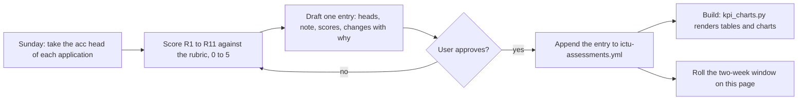

# ICTU Dependency Guideline

ICTU publishes eleven recommendations for managing dependencies: everything a build pulls in, direct and indirect,
including images, hooks and pipeline definitions. The three applications are scored against them every Sunday, on a
0–5 scale per recommendation. This page owns those scores; the mechanisms behind them are on the control pages, mapped
in [Controls at a Glance](controls.md).

!!! info "Sources and scope"
    The guideline and the assessment of record live in the Linked Data Explorer repository, on `acc`:
    [`ICTU-dependencies-guideline.md`](https://github.com/sgort/linked-data-explorer/blob/acc/docs/ICTU-dependencies-guideline.md)
    and
    [`ICTU-dependencies-assessment.md`](https://github.com/sgort/linked-data-explorer/blob/acc/docs/ICTU-dependencies-assessment.md),
    which holds the rubric and the evidence each recommendation asks for. The weekly scores are kept in this
    repository, in `docs/data/ictu-assessments.yml`. CPRMV, the Norm Editor and this documentation site are not scored.

## The eleven recommendations

| ID | Group | What it asks |
|---|---|---|
| R1 | Adding | Vet a dependency before adding it: licence, maintainers, release policy, activity, open security issues |
| R2 | Specifying | No unpinned tags: no `latest`, no tag that does not name a version |
| R3 | Specifying | Pin at the highest precision (`3.14.5`, not `3.14`); no ranges unless the software is a library |
| R4 | Specifying | Pin by hash: digests, and a committed lockfile installed with `npm ci` |
| R5 | Specifying | Install through an internal registry or proxy, and verify origin (signatures, provenance) |
| R6 | Updating | A cooldown of at least 7 days, configured in the tools; skippable for critical security fixes |
| R7 | Updating | Assess a major before taking it; wait for its first or second patch release when it is risky |
| R8 | Updating | Update periodically, driven by tooling |
| R9 | Updating | Treat an update like any change: a reviewed pull request, the whole pipeline green, transitive changes reviewed, no automerge |
| R10 | Monitoring | Audit daily, including released versions; mitigate each finding or explicitly accept it |
| R11 | Monitoring | Re-check quarterly that dependencies are still maintained (the same points as R1) |

The guideline permits deviations for valid reasons, so a written reason counts towards meeting it.

## How a week is scored

- **Cadence.** One assessment per week, on Sunday, as part of the weekly pass. It reads each application's `acc`, the
  branch of record, so work counts once it reaches `acc`, before promotion to `main`.
- **Evidence.** The repositories at those heads, their workflow runs and the GitHub API (rulesets, Renovate pull
  requests, Dependabot alerts), read the way the assessment of record describes.
- **Record.** One entry per week in `docs/data/ictu-assessments.yml`: the date, `kind` (`measured`, or
  `reconstructed` for a week scored afterwards), the three `heads`, a `note`, eleven scores per application, and for
  every cell that moved, `from`, `to` and `why`. The same file holds the weekly test figures under `tests`.
- **Approval.** The scores are proposed, not self-certified: the user approves them before the entry is written.
- **Rendering.** `hooks/kpi_charts.py` replaces each `ictu:` placeholder on this page with a table or inline SVG
  chart built from the data file. A score is corrected in the data file, nowhere else.

**How to read the scores.** 0 absent or contradicted · 1 incidental only · 2 partly met, large gaps · 3 mostly met, a
clear gap · 4 met, a small gap · 5 fully met, and enforced rather than intended. Where a recommendation concerns a human
practice that leaves no trace (reading release notes, checking maintenance), only what a repository records counts.

## Current scores

The current scores are those of the assessment of 22 November 2026, read at `3ba847f` (CPSV Editor), `fe841f9`
(Linked Data Explorer) and `be0a1f0` (RONL Business API). The next assessment, on Sunday 29 November, reads the `acc`
heads of that day. The superscript in the table is the change since the previous week.

<!-- ictu:scores -->

<!-- ictu:heatmap -->

All three are strongest where tooling does the work (digest-pinned actions, Renovate under a 14-day cooldown, a build
that ships what the tests ran on) and weakest where it does not reach: R5 asks for a registry that does not exist here.

### Over time

<!-- ictu:totals -->

A filled marker is a week scored on the day; a hollow marker is a week scored afterwards from the commits on `acc`
that Sunday, worth about ±1 per cell.

<!-- ictu:movement -->

## Why each score

One line per recommendation, as the 22 November assessment reads each application.

### CPSV Editor — 42 of 55

| | Score | Why |
|---|:-:|---|
| R1 | 3 | Criteria are written down in `dependency-criteria.md` and `lockfile-review` lists every new direct dependency with a checklist, but nothing fails on an unticked box. |
| R2 | 4 | Every job runs on `ubuntu-24.04`, actions are pinned by digest and Node is pinned to `24.22.2`; the Static Web Apps upload container still floats, though it builds nothing. |
| R3 | 3 | No deploy path re-resolves a range, since the bundle comes from the runner's `npm ci`; the manifest still holds caret ranges. |
| R4 | 4 | Action digests, a committed lockfile and `npm ci` for what ships; Semgrep's `pip install semgrep==1.176.1` has no `--require-hashes`. |
| R5 | 2 | `npm audit signatures` runs in the required `audit` job and `lockfile-review` fails on a foreign origin or a missing `integrity`; there is no internal registry or proxy. |
| R6 | 4 | Renovate's `minimumReleaseAge` is 14 days, with a security-fix exception, and `.npmrc` sets `min-release-age=14`, which npm 11.19 honours; nothing in CI checks that a lock-file refresh respects it. |
| R7 | 5 | Renovate never proposes an npm `X.0.0`, majors wait for Dependency Dashboard approval, and deferred majors carry written reasons in `renovate.json`. |
| R8 | 5 | Renovate updates merge in weekly batches, lock-file maintenance included. |
| R9 | 4 | Every update is a pull request with no automerge, `Build and deploy ACC` and `lockfile-review` are required on `acc`; no ruleset requires an up-to-date branch or an approving review. |
| R10 | 4 | `dependency-audit.yml` audits `acc` and `main` daily and every release commits an SBOM; one development `minimatch` medium is neither fixed nor dismissed. |
| R11 | 4 | `dependency-review.yml` runs quarterly and opens an issue with an outcome per flagged package; it has run once, by hand, and its first scheduled run is 2 January 2027. |

### Linked Data Explorer — 40 of 55

| | Score | Why |
|---|:-:|---|
| R1 | 3 | The same criteria and checklist; new direct dependencies (`tsx` among them) pass it with no box ticked. |
| R2 | 4 | Jobs on `ubuntu-24.04`, actions by digest, Node `24.22.2` in `.nvmrc`; the App Service runtime `NODE\|24-lts` names a major only, a recorded deviation. |
| R3 | 3 | The backend deploys with `npm ci --omit=dev` and the frontends are built on the runner, so no install re-resolves a range; the manifests still hold caret ranges. |
| R4 | 4 | Lockfile integrity hashes reach every deployable; Semgrep's `pip install` has no `--require-hashes`. |
| R5 | 2 | Signature and provenance check in the required `audit` job and the `lockfile-review` origin check; the registry question is open in [linked-data-explorer#249](https://github.com/sgort/linked-data-explorer/issues/249). |
| R6 | 4 | The same Renovate and `.npmrc` cooldowns, honoured by npm 11.19; nothing in CI checks a lock-file refresh against it. |
| R7 | 5 | npm `X.0.0` excluded by `allowedVersions`, majors behind approval, deferrals with reasons. |
| R8 | 4 | Renovate updates merge in weekly batches; the lock-file refresh merged once after a month open, and the next one is open again. |
| R9 | 4 | The deploy and build checks and `lockfile-review` are required on `acc` and run on a lockfile-only change; no up-to-date or review requirement. |
| R10 | 3 | The daily audit and release SBOMs are in place, but its three open Dependabot alerts are neither dismissed nor accepted in writing. |
| R11 | 4 | The quarterly review ran once, by hand, with an outcome for every flagged package; the schedule has not yet fired. |

### RONL Business API — 40 of 55

| | Score | Why |
|---|:-:|---|
| R1 | 3 | The same criteria and checklist, and informal design notes; nothing fails on an unticked box. |
| R2 | 4 | Jobs on `ubuntu-24.04`, actions by digest; Skosmos on the VM is spelled `:latest` (digest-pinned) and Keycloak `23.0` names no patch. |
| R3 | 3 | The backend deploys from CI with `npm ci --omit=dev`; the two hand-run `deploy-backend-to-*.sh` scripts remain as a break-glass path, and the manifests hold caret ranges. |
| R4 | 4 | Lockfile integrity hashes for every deployable and digests on the local stack's images; the VM's Keycloak images and the test harness's Operaton `1.0.0` carry no digest. |
| R5 | 2 | The same signature, provenance and origin checks; no internal registry or proxy. |
| R6 | 4 | The Renovate and `.npmrc` cooldowns are set, but `.nvmrc` names Node `22.23.4`, whose npm 10.9.9 ignores `min-release-age` silently (it needs 11.10). |
| R7 | 4 | npm `X.0.0` excluded and Ubuntu and Node 24 deferred with reasons; fourteen majors wait for approval without a written assessment. |
| R8 | 4 | Lock-file maintenance and Renovate updates merge, but irregularly: nothing from Renovate merged in the week to 22 November. |
| R9 | 4 | `build`, the three ACC deploy checks and `lockfile-review` are required on `acc` and run on a lockfile-only change; no up-to-date or review requirement. |
| R10 | 4 | Each alert is fixed, dismissed with a reason on the alert, or accepted in writing in `SECURITY-PIPELINE.md` with a revisit trigger; three stay open on purpose, and nothing checks the register against the open alerts. |
| R11 | 4 | The quarterly review ran once, by hand, with an outcome for every flagged package; the schedule has not yet fired. |

<!-- Two-week window: the weekly pass adds the newest week and drops the oldest. -->

## What moved in the last two weeks

### Week to 15 November: R8 up in all three

Totals 42, 40 and 40, from 41, 39 and 39. Lock-file maintenance merged in all three applications on 12 November,
after 38, 31 and 24 days open, and took the Renovate backlog with it: on the Sunday one Renovate pull request was open
in the CPSV Editor, one in the Linked Data Explorer and none in the RONL Business API. R8 moved from 4 to 5 in the
CPSV Editor (16 Renovate merges in 30 days, every version in the refresh at least 15 days old) and from 3 to 4 in the
other two. The Linked Data Explorer's refresh carried the `follow-redirects` fix its daily audit had asked for since
31 October, and the audit has passed since; its R10 stays 3. The sign-in work brought `keycloak-js` into two
applications and `jsonwebtoken` and `jwks-rsa` into the Linked Data Explorer's backend, with no checklist box ticked.

### Week to 22 November: no cell moved

Totals hold at 42, 40 and 40. The lock-file refreshes Renovate opened on 16 November were still open in all three on
the Sunday, green apart from Renovate's own pending stability check, so the catch-up of 12 November is not yet a
cadence. The CPSV Editor merged a weekly batch of six other updates and the Linked Data Explorer four; the RONL
Business API merged none, which makes its R8 the cell to watch. The RONL Business API fixed eight Dependabot alerts
([ronl-business-api#469](https://github.com/sgort/ronl-business-api/pull/469)), dismissed two development mediums
with a reason, and recorded a reason and a revisit trigger for each of the three it keeps open
([ronl-business-api#470](https://github.com/sgort/ronl-business-api/pull/470)); its R10 stays 4 because that
acceptance is written, not enforced. `tsx` entered the Linked Data Explorer's backend with no checklist box ticked.
The Linked Data Explorer's audit went red once, on 18 November, on a `picomatch` advisory GitHub withdrew that day
([linked-data-explorer#345](https://github.com/sgort/linked-data-explorer/issues/345), closed by the next run).

The reasons for every cell that moved in the last three passes:

<!-- ictu:changes -->

## What the guideline does not measure

The guideline scores how dependencies are managed, not whether the code works. Test work barely registers in the
scores, so it is charted separately, from the `tests` series in the same data file.

<!-- ictu:tests -->

<!-- ictu:testgates -->

Read the columns as: test files · end-to-end specs · workflows running a suite, of the workflows in the repository · a
per-file coverage floor in the runner configuration. Counted from the tree at each weekly commit: files ending in
`.test.*` or `.spec.*`, end-to-end specs under an `e2e/` directory, workflows that run a suite (tooling tests such as
`lockfile-review`'s included), and runner configurations with a per-file floor. Test-case counts and coverage
percentages are on each application's testing page; the gates themselves are on
[Tests & Coverage Gates](coverage-floor.md).

## Where it lives

| What | Where |
|---|---|
| The guideline | [`docs/ICTU-dependencies-guideline.md`](https://github.com/sgort/linked-data-explorer/blob/acc/docs/ICTU-dependencies-guideline.md), Linked Data Explorer `acc` |
| The rubric and the assessment of record | [`docs/ICTU-dependencies-assessment.md`](https://github.com/sgort/linked-data-explorer/blob/acc/docs/ICTU-dependencies-assessment.md), Linked Data Explorer `acc` |
| The criteria for R1 and R11 | [`docs/dependency-criteria.md`](https://github.com/sgort/linked-data-explorer/blob/acc/docs/dependency-criteria.md), Linked Data Explorer `acc` |
| The weekly scores and test figures | `docs/data/ictu-assessments.yml`, this repository |
| The renderer of every table and chart here | `hooks/kpi_charts.py`, this repository; chart colours in `docs/stylesheets/extra.css` |
