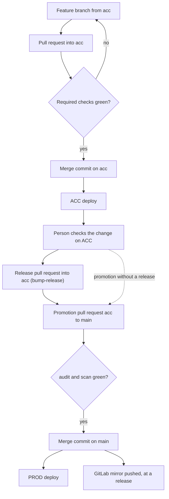

# Contributing

This section describes how the five IOU repositories are built, checked and released as they are now: which branch a
change goes into, which checks must pass before it merges, how it reaches acceptance and production, and what each
build records. Each mechanism has its own page; [Controls at a Glance](controls.md) shows all of them side by side.

## The repositories

| Component | Repository | CI runs on | Branches | Issues | Release numbering |
|---|---|---|---|---|---|
| CPSV Editor | [sgort/ttl-editor](https://github.com/sgort/ttl-editor) | GitHub Actions | `acc`, `main` | [GitHub](https://github.com/sgort/ttl-editor/issues) | CalVer `YYYY.MM.N` |
| Linked Data Explorer | [sgort/linked-data-explorer](https://github.com/sgort/linked-data-explorer) | GitHub Actions | `acc`, `main` | [GitHub](https://github.com/sgort/linked-data-explorer/issues) | CalVer `YYYY.MM.N`, one sequence for all packages |
| RONL Business API | [sgort/ronl-business-api](https://github.com/sgort/ronl-business-api) | GitHub Actions | `acc`, `main` | [GitHub](https://github.com/sgort/ronl-business-api/issues) | CalVer `YYYY.MM.N` |
| CPRMV | [open-regels/cprmv](https://github.com/open-regels/cprmv) | GitHub Actions; GitLab CI publishes the ReSpec only | `acc`, `main` | [GitHub](https://github.com/open-regels/cprmv/issues) | release `vYYYY.MM.N` beside a vocabulary version |
| Norm Editor | [regels/editor](https://git.open-regels.nl/regels/editor) (GitLab) | GitLab CI | `main` | [GitLab](https://git.open-regels.nl/regels/editor/-/issues) | git tags `YYYY.MM.N`, plus a SemVer version per service |

`acc` is the default branch of the four GitHub repositories; `main` is production. The three applications and CPRMV
keep a copy on `git.open-regels.nl` that is pushed by hand ([The GitLab Mirror](the-gitlab-mirror.md)); issues and
pull requests go to GitHub. Every IOU component is moving to the `open-regels` GitHub organisation; CPRMV is there
already.

## How a change travels

1. **Feature branch.** Work starts on a branch from `acc`; nothing is committed to `acc` or `main` directly. See
   [Branches & Promotion](branch-protection.md).
2. **Pull request into `acc`.** A ruleset makes the pull request the only way in and names the checks that must pass:
   the supply-chain `audit`, the Semgrep `scan`, the `lockfile-review` ([Pinning](supply-chain.md),
   [Dependencies](dependency-scanning.md)) and the deploy workflows' build jobs, which run lint, type checks and the
   unit suites under a per-file coverage floor ([Tests & Coverage Gates](coverage-floor.md),
   [Code Standards & Hooks](code-standards.md)). CPRMV requires `audit`, `scan`, `test` and `build`. In the three
   applications, git hooks run lint and format before the push.
3. **ACC deploy.** The merge pushes `acc`, which fires the acceptance deploys. Each build stamps its commit and run
   number, and the backend deploys wait until `/health` reports that commit ([Build Provenance](build-provenance.md)).
4. **Check on ACC.** A person checks the change in the acceptance environment. No ruleset or workflow records that
   check.
5. **Release.** `/bump-release` sets the version, writes the release SBOM and lands both through another pull request
   into `acc` ([Branches & Promotion](branch-protection.md#releases), [Build Provenance](build-provenance.md#release-sboms)).
6. **Promotion pull request.** A pull request from `acc` into `main`, which requires `audit` and `scan` (CPRMV: also
   `test` and `build`) ([Branches & Promotion](branch-protection.md#what-blocks-a-merge)).
7. **PROD deploy.** The merge pushes `main`, which fires the production deploy; it runs lint and the suites again
   before it builds ([Branches & Promotion](branch-protection.md#deploys-per-branch)).
8. **GitLab mirror.** At a release, `acc` and `main` are fast-forwarded to GitLab by hand; for CPRMV the push of
   `main` publishes the ReSpec ([The GitLab Mirror](the-gitlab-mirror.md)).

In CPRMV, `/bump-release` runs steps 5 to 8 itself, opening each pull request for a person to merge. The Norm Editor
has no `acc` branch: its pipeline runs tests and builds images on `main`, Maintainers can push to `main` directly, and
no pipeline result blocks a merge ([Code Standards & Hooks](code-standards.md#the-norm-editor-is-shaped-differently)).

How a piece of work is designed, planned and handed over before step 1 is on
[Development Workflow](development-workflow/overview.md).

## Where to read next

1. [Controls at a Glance](controls.md): every control, per repository, in one matrix.
2. [Branches & Promotion](branch-protection.md): rulesets, required checks, deploys and releases.
3. [Pinning](supply-chain.md): actions, images, lockfiles and toolchains, and Renovate.
4. [Dependencies](dependency-scanning.md): the lockfile review, the dependency register, audits, Semgrep.
5. [Tests & Coverage Gates](coverage-floor.md): which suites run where, and the coverage floor.
6. [Code Standards & Hooks](code-standards.md): lint, format, type checks and git hooks.
7. [Build Provenance](build-provenance.md): build ids, `/health`, attestations and release SBOMs.
8. [The GitLab Mirror](the-gitlab-mirror.md): which repositories mirror, and when.
9. [ICTU Dependency Guideline](ictu-dependency-guideline.md): the eleven recommendations and today's scores.
10. [Development Workflow](development-workflow/overview.md): from design to promotion.
11. [Working with Claude Code](development-workflow/working-with-claude-code.md): plugins, skills and working
    boundaries.
12. [Documentation Architecture](doc-architecture/overview.md): how this site is built and deployed.

## Licence and contact

The IOU Architecture Framework is published under the
[European Union Public Licence v1.2 (EUPL-1.2)](https://eupl.eu/1.2/en/), and participation follows the
[Contributor Covenant Code of Conduct](https://www.contributor-covenant.org/version/2/1/code_of_conduct/). Questions,
and conduct reports in confidence, go to Steven Gort (ICTU), [steven.gort@ictu.nl](mailto:steven.gort@ictu.nl).

Not a developer? [Submit a use case →](../../use-case-form.html){ .md-button .md-button--primary }
