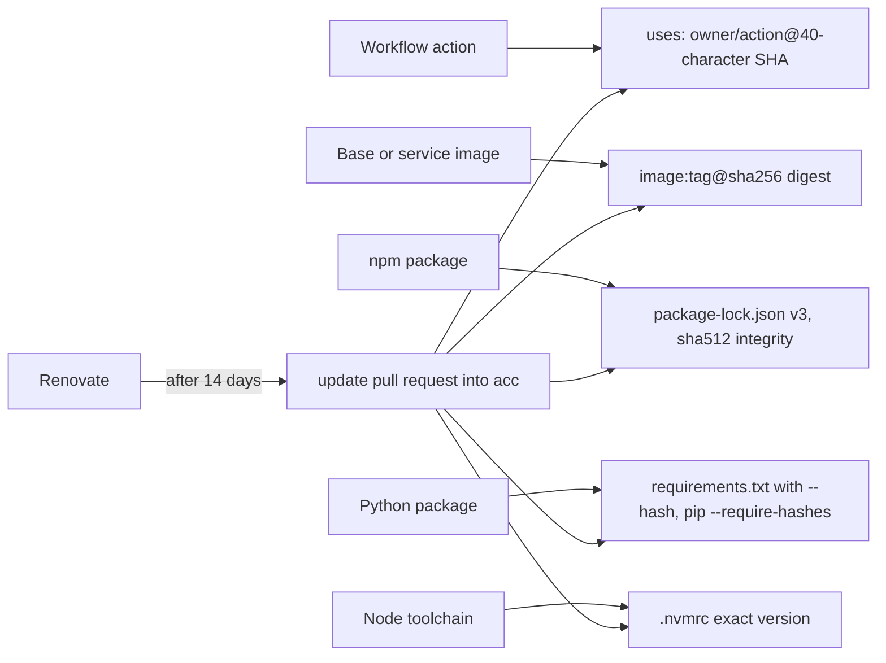

# Pinning

Pinning guards against code changing underneath a build without a change in the repository: a moved tag, a
re-pointed image, a package version published this morning. Every input a build fetches is named by something
that cannot move: a commit hash for a workflow action, a digest for a container image, an integrity hash for an
npm package, a `--hash` for a Python package. Renovate keeps those pins current, and proposes nothing younger
than 14 days.

What happens to a pull request that changes the pins (the lockfile review, the cooldown check, the audits) is on
[Dependencies](dependency-scanning.md).

## How it works

1. **Actions.** Every `uses:` names a full commit SHA with the version as a comment
   (`actions/checkout@3d3c42e… # v7.0.1`). `.github/zizmor.yml` sets the `unpinned-uses` policy to `hash-pin` for
   every action, first-party included, and the `audit` job runs zizmor on every pull request.
2. **Pin truth.** zizmor checks the format of a pin, not that it is the right commit. In the three applications,
   `npm run check-supply-chain` (in `audit`) resolves every SHA through the GitHub API and compares the workflows
   with the register in `SECURITY-PIPELINE.md`: digests, versions, counts.
3. **Images.** Images are written `name:tag@sha256:…` (index digests, so the pin holds on amd64 and arm64).
   Renovate's `docker:pinDigests` keeps them current where it is enabled.
4. **npm.** `package-lock.json` (lockfileVersion 3) records a `sha512` integrity and a registry origin for every
   package. CI and every deploy install with `npm ci`, which installs exactly the lockfile. The `audit` job also
   runs `npm ci --dry-run --ignore-scripts`, so a lockfile that does not match `package.json` fails under its own
   name.
5. **Python (CPRMV).** `serve_api/requirements.txt` and `requirements-dev.txt` are compiled by `pip-compile
   --generate-hashes` on Linux, Python 3.14, `pip-tools==7.6.2`. The image installs with `--require-hashes
   --no-deps`; the `audit` job recompiles and fails on drift, and dry-runs both files with `--require-hashes`.
6. **Renovate** proposes updates to all of the above, waits 14 days after a release, and opens its pull requests
   against `acc`.

## What is pinned, per repository

| Component | Workflow actions | Runner | Node | Python | Packages | Container images |
|---|---|---|---|---|---|---|
| CPSV Editor | 21 `uses:` in 8 workflows, all SHA | `ubuntu-24.04` | `.nvmrc` 24.22.3 | — | `package-lock.json`, integrity | none built |
| Linked Data Explorer | 35 in 12 workflows, all SHA | `ubuntu-24.04` | `.nvmrc` 24.22.3; `engines.node` `>=24.22.1` | — | root `package-lock.json` (workspaces) | none built |
| RONL Business API | 45 in 15 workflows, all SHA | `ubuntu-24.04` | `.nvmrc` 24.22.3; `engines` node `>=24.22.1`, npm `>=11.10.0` | — | root `package-lock.json` (workspaces) | `docker-compose.yml`: six images, tag and digest; `deployment/vm/`: see below |
| CPRMV | 22 in 5 workflows, all SHA; `bats-core` checked out at a SHA | `ubuntu-24.04` | `24.22.2` literal, for the Renovate validator only | CI `python-version: '3.14'`; image `python:3.14-bookworm@sha256:…` | `requirements*.txt` with hashes | API image, Caddy and the GitLab Pages `node:26-alpine`, all by digest |
| Norm Editor | no GitHub Actions; GitLab CI jobs | GitLab CI images by tag (`docker:latest`, `node:24`, `python:3.14.6`) | Dockerfiles `node:24.13.0`, by tag | Dockerfiles `python:3.11-alpine`, `python:3.14`, by tag | `backend` `npm ci`; `gui` has `package-lock.json` and `yarn.lock` and installs with `npm install`; Python `requirements.txt` exact versions, no hashes | by tag, several `:latest`; no digests |

Workflows set Node either from `.nvmrc` (`node-version-file`) or as the literal `'24.22.3'`; the literal is used by
jobs that run tools rather than the application (the audit, the config validator, the daily audit, which reads
both branches). Renovate maintains both.

**RONL Business API's VM files.** `deployment/vm/` holds compose files that are applied by hand on the virtual
machines, not by a workflow. Caddy (`caddy:2.11.9-alpine`), Operaton production (`operaton/operaton:1.0.0`),
Skosmos and both Postgres images are pinned by digest; `quay.io/keycloak/keycloak:23.0` (ACC and PROD) and the
Operaton image in `deployment/vm/operaton/test/` are pinned by tag only. A pin there records what a VM should run;
nothing reads what it does run.

**CPRMV's deployed image.** The VM reconciler pulls `ghcr.io/open-regels/cprmv-api:sha-<commit>`, resolves its
digest and runs the image by that digest.

### Tools pinned by hand

Renovate does not parse a version inside a `run:` block or an `npx` argument, so these move by hand:

| Tool | Pin | Where |
|---|---|---|
| Renovate config validator | `npx --package renovate@44.50.3` | `zizmor.yml`, all four GitHub repositories |
| Semgrep | `pip install semgrep==1.176.1` into a venv | `semgrep.yml`, all four |
| pip-tools | `pip-tools==7.6.2` (also `constraints.pipTools` in `renovate.json`) | CPRMV `zizmor.yml`, `serve_api/Makefile` |
| pip-audit | `pip-audit==2.10.1` | CPRMV `dependency-audit.yml`, `ci.yml` |
| cyclonedx-bom | `cyclonedx-bom==8.0.1` | CPRMV `sbom.yml` |

zizmor itself is the `version: '1.29.0'` input of `zizmor-action`. Renovate tracks it as the image
`ghcr.io/zizmorcore/zizmor` in the `github actions` group, and the action installs it from a hash-locked
requirements file it ships per version, so the action bump and the version bump merge together.

## Renovate, per repository

All four GitHub repositories extend `config:recommended` and `helpers:pinGitHubActionDigests`, set
`minimumReleaseAge: "14 days"` and `internalChecksFilter: "strict"`, and target `acc` (the default branch;
Linked Data Explorer and RONL Business API also name it in `baseBranchPatterns`). Pull requests never target
`main`, which changes only by promotion.

| Component | Extra extends | Majors | `0.x` minors | Groups | PR limits | Holds |
|---|---|---|---|---|---|---|
| CPSV Editor | — | Dashboard approval; never `X.0.0` (npm) | routine | none | 5 open, 2 per hour | `tailwindcss` major, `eslint` major, `ubuntu` major, `Azure/static-web-apps-deploy` |
| Linked Data Explorer | `:dependencyDashboard` | Dashboard approval; never `X.0.0` (npm) | Dashboard approval | github actions; backend, frontend, ropa-site | 5 open, 2 per hour | `ubuntu` major, `Azure/static-web-apps-deploy` |
| RONL Business API | `:dependencyDashboard`, `docker:pinDigests` | Dashboard approval; never `X.0.0` (npm) | Dashboard approval | github actions; backend, frontend, pa-demo, public-site | 5 open, 2 per hour | `ubuntu` major, `Azure/static-web-apps-deploy`, Docker `redis` held to 7.0–7.2 |
| CPRMV | `docker:pinDigests` | Dashboard approval; never `X.0.0` (PyPI) | routine | Python minor and major, behind approval | 2 open | `ubuntu` major |
| Norm Editor | not in place: no Renovate configuration | — | — | — | — | — |

- **Schedule.** Updates are proposed whenever they clear the 14 days. Lock-file maintenance, the only update
  that refreshes transitive packages, runs `before 5am on monday`. In the three applications it is exempt from
  both PR limits (`prConcurrentLimit: 0`, `prHourlyLimit: 0` on its own rule); in CPRMV it has priority within the
  limit.
- **Security lane.** `vulnerabilityAlerts` sets `minimumReleaseAge: null`, the label `security`, and no Dashboard
  approval, so a fix for an advisory is proposed at once, majors included. It reads Dependabot alerts, which are
  enabled on all four repositories; Dependabot security updates are disabled, so nothing opens competing pull
  requests that ignore the cooldown.
- **`engines`.** Linked Data Explorer and RONL Business API apply `rangeStrategy: widen` to `engines`, so Renovate
  never raises the floor. RONL Business API's `engines.npm` `>=11.10.0` is also the npm Renovate installs for
  itself, and so the floor of the cooldown below.
- **CPRMV specifics.** The `pip-compile` manager maintains both requirements files. A `customManagers` regex finds
  the base image a second time in `serve_api/Makefile` (`PY_IMAGE = python:…@sha256:…`), so the Dockerfile and the
  Makefile move in one pull request; a Python minor needs the requirements recompiled on that pull request.

### The cooldown stops at the manifest

Renovate's `minimumReleaseAge` holds back the updates Renovate proposes. It does not reach the transitive tree:
for lock-file maintenance Renovate hands resolution to the package manager. The package manager therefore
carries the cooldown too.

| Component | Renovate's own updates | `npm install`, `npm update`, lock-file maintenance | `npm ci` | Workstation check |
|---|---|---|---|---|
| CPSV Editor | 14 days | `.npmrc` `min-release-age=14` | installs the lockfile as it is | `deps:check` warns below npm 11.10 |
| Linked Data Explorer | 14 days | `.npmrc` `min-release-age=14` | installs the lockfile as it is | `deps:check` warns below npm 11.10 |
| RONL Business API | 14 days | `.npmrc` `min-release-age=14` | installs the lockfile as it is | `deps:check` fails below npm 11.10 |
| CPRMV | 14 days | not in place: pip has no cooldown, so the weekly `pip-compile` refresh resolves current releases | — | — |
| Norm Editor | not in place | not in place | — | — |

npm enforces `min-release-age` from 11.10; older npm ignores it without a warning. The pinned Node 24.22.3 bundles
an npm that enforces it, and `deps:check` (`scripts/check-deps.sh`, run at dev-server start and in the pre-push
hook) flags a workstation on an older npm. An urgent fix may pass `--min-release-age=0` on one command line,
never in `.npmrc`, with the reason in the pull request.

`npm ci` ignores the setting on purpose, so the lockfile itself is checked when it changes: the `lockfile-review`
job fails a pull request that adds or changes any package version younger than 14 days. That check, its
exceptions, and RONL Business API's daily proof that npm really refuses a young version are on
[Dependencies](dependency-scanning.md#the-cooldown-on-lockfile-versions).

## What this does not protect

- **The Static Web Apps deploy container.** `Azure/static-web-apps-deploy` runs
  `mcr.microsoft.com/appsvc/staticappsclient:stable`, a floating tag inside a third-party action. Every deploy that
  builds an app sets `skip_app_build: true`, so the bundle is built on the runner from `npm ci` and the container
  only uploads it; it still receives the deploy token and the bundle. Linked Data Explorer's `ropa-site` has no
  `package.json` and is uploaded as it is, without `skip_app_build`.
- **`Azure/static-web-apps-deploy@v1` moves by hand.** `v1` is both a 2021 tag and a 2024 branch head; the
  workflows pin the branch head `4d27395…`, and Renovate updates for this action are disabled because it would
  resolve the tag.
- **The runner image.** `ubuntu-24.04` pins the Ubuntu release, not the image; GitHub rebuilds it and a hosted
  runner cannot be pinned to a digest. Renovate holds the `ubuntu` major.
- **The App Service runtime.** The Linked Data Explorer and RONL Business API backends run on Azure App Service,
  whose Node runtime is set as `NODE|<major>-lts`: a major, nothing finer.
- **Tools and what they install.** The hand-pinned tools above fix their own version, not their transitive
  dependencies.
- **Pin truth in CPRMV.** CPRMV has no `check-supply-chain`; the register in its `SECURITY-PIPELINE.md` is kept by
  hand, and `shellcheck` is the runner's, unpinned.
- **CPRMV's Python minor.** CI names `python-version: '3.14'`, a minor; the image pins a digest.
- **Hand-applied VM files.** RONL Business API's `deployment/vm/` compose files are pulled by hand, and the Keycloak
  images and the Operaton test image pin by tag only.
- **The Norm Editor.** None of the controls on this page is in place: no Renovate, no digests, `:latest` tags, a
  GUI image built with `npm install`, Python requirements without hashes.

## Where it lives

| What | Path |
|---|---|
| Pin policy for zizmor | `.github/zizmor.yml` |
| Pin checks (`audit` job) | `.github/workflows/zizmor.yml`; `scripts/check-supply-chain.mjs` (applications) |
| Pin register and exceptions | `SECURITY-PIPELINE.md` in each repository |
| Renovate policy | `renovate.json` |
| Node version | `.nvmrc`; `engines` in `package.json` |
| npm cooldown | `.npmrc` (`min-release-age=14`) |
| Workstation toolchain check | `scripts/check-deps.sh` (`npm run deps:check`) |
| Lockfiles | `package-lock.json`; CPRMV `serve_api/requirements.txt`, `serve_api/requirements-dev.txt` |
| CPRMV base image | `serve_api/Dockerfile` line 1 and `PY_IMAGE` in `serve_api/Makefile` |
| Images | RONL Business API `docker-compose.yml`, `deployment/vm/**/docker-compose.yml`; CPRMV `deployment/vm/{acc,stable}/compose.yml`, `.gitlab-ci.yml` |
| Required checks | the `acc supply-chain gate` and `main promotion gate` rulesets; see [Branches & Promotion](branch-protection.md) |
