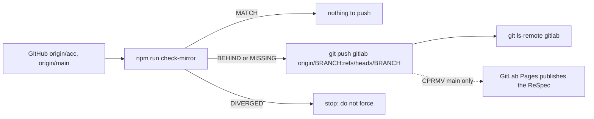

# The GitLab Mirror

Development, pull requests and CI for the three applications, CPRMV and this documentation site live on GitHub. Each
also has a copy on `git.open-regels.nl` (GitLab), and nothing pushes that copy automatically: a person pushes it, by
hand, with a fast-forward from the GitHub branch. This page says which repositories have a mirror, which branches go
there and when.

## How it works

1. **A release, or a merged pull request here.** The three applications and CPRMV reconcile their mirror at a release,
   as the last steps of `/bump-release`. This documentation site has no releases; its mirror is pushed after each
   merged pull request, during housekeeping.
2. **Compare.** `npm run check-mirror` (`scripts/check-mirror.sh`) fetches `origin` and `gitlab` and reports each of
   `acc` and `main` as `MATCH`, `BEHIND by N`, `MISSING` or `DIVERGED`. For a branch that is behind or missing it prints
   the push command and exits non-zero. It never pushes.
3. **Push.** A person runs the printed command. It names the remote-tracking branch (`origin/acc`), so what goes to
   GitLab is what GitHub holds, not whatever the local branch happens to be.
4. **Diverged means stop.** If GitLab holds commits GitHub does not, the branch is not fast-forwardable. It is archived
   on GitLab under another name, never forced into line.
5. **Confirm** with `git ls-remote gitlab` that both heads match GitHub.

The `gitlab` remote exists only in each clone's `.git/config`; no tracked file names it. A CI runner has no such
remote and no credentials for it, so the check runs on the workstation that pushes. On a clone without a `gitlab`
remote, `check-mirror` says so and exits 0.

## Per repository

| Repository | GitLab project | Branches mirrored | Pushed when | How | Pipeline on GitLab |
|---|---|---|---|---|---|
| CPSV Editor | `showcases/ttl-editor` | `acc`, `main` | at a release | `/bump-release` ends with `npm run check-mirror` | none (no `.gitlab-ci.yml`) |
| Linked Data Explorer | `hosting/linked-data-explorer` | `acc`, `main` | at a release | `/bump-release` ends with `npm run check-mirror` | none |
| RONL Business API | `hosting/ronl-business-api` | `acc`, `main` | at a release | `/bump-release` ends with `npm run check-mirror` | none |
| CPRMV | `standards/cprmv` | `main` only; GitLab's `acc` is not kept current | every release | step 6 of `/bump-release` pushes `main` (fast-forward checked with `git merge-base --is-ancestor`) | `create-pages`: publishes the ReSpec |
| Norm Editor | `regels/editor` | — | — | GitLab is its only remote (`origin`); there is no mirror | `.gitlab-ci.yml` (tests, image builds) |
| This site (`iou-architectuur`) | `showcases/iou-architectuur` | `acc`, `main` | after each merged pull request | housekeeping: fast-forward push of `acc` and `main`, then `git ls-remote gitlab` | none |

Between releases the application mirrors lag GitHub; that is expected. At the verified heads every mirrored branch
matched GitHub.

`scripts/check-mirror.sh` is the same file in all three applications.

### CPRMV: the mirror that publishes

CPRMV's GitLab project is where its ReSpec is served from. `.gitlab-ci.yml` holds one job, `create-pages`, which runs
only when `main` is pushed and publishes the prebuilt `html/public` directory to
`https://standaarden.open-regels.nl/standards/cprmv/`. Nothing else runs on GitLab. Pushing `main` there is therefore
a publication, and it is a fixed step of every CPRMV release: running `/bump-release` is the go-ahead for that push.
The command checks before pushing (`equal`, `behind`, or `DIVERGED`, which stops it), pushes
`origin/main:refs/heads/main`, confirms with `git ls-remote gitlab refs/heads/main`, and then asks for the Pages
pipeline of that commit to be confirmed in the GitLab UI. Outside a release, a push of CPRMV's `main` to GitLab still
publishes, so it is asked for first.

## What it does not cover

- **No gate runs on GitLab.** Rulesets, required checks and every CI control on these pages run on GitHub Actions. A
  mirror carries the same commits, not the same guarantees.
- **No automatic sync.** Nothing pushes the mirror and nothing alerts when it lags; `check-mirror` runs only when a
  person runs it.
- **The application mirrors are not current between releases**, and CPRMV's GitLab `acc` is not current at all.
- **The commit links on this site point at GitHub**, where the deploy runs are, not at the mirror
  ([Build Provenance](build-provenance.md)).

## Where it lives

| What | Where |
|---|---|
| The check | `scripts/check-mirror.sh`, run as `npm run check-mirror` (CPSV Editor, Linked Data Explorer, RONL Business API) |
| When it runs | the GitLab-mirror step near the end of `.claude/commands/bump-release.md` in each of those repositories |
| CPRMV push | step 6, "Push `main` to GitLab", in `cprmv/.claude/commands/bump-release.md` |
| CPRMV Pages job | `cprmv/.gitlab-ci.yml` |
| The remote | `git remote -v` in each clone (local configuration, not in the repository) |
