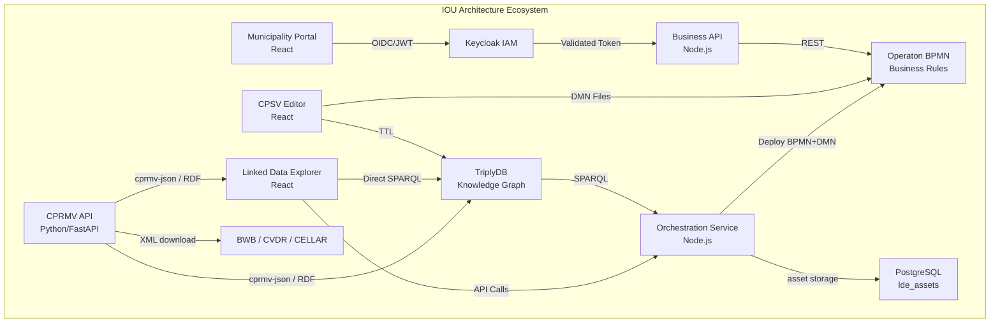

# IOU Architecture Documentation

Welcome to the comprehensive documentation for the IOU Architecture Framework and the RONL ecosystem.

---

## What is this?

### What is IOU Architecture?

The Information Architecture Framework for IOU integrates semantic web technologies, decision models, and Dutch government standards into a unified system for managing regulatory compliance and spatial planning.

<figure style="width:100%; margin:0;">
  <iframe src="architecture-diagram.html"
          width="100%"
          height="700px"
          frameborder="0"
          style="border-radius:12px; display:block;">
  </iframe>
  <figcaption>IOU Architecture — interactive overview of the ecosystem components and their relationships</figcaption>
</figure>

---

### Architecture Overview

---

### Ecosystem Components

#### ⚙️ RONL Business API

The core business API layer that provides secure authentication and process orchestration for Dutch government services.

**Live App**: [mijn.open-regels.nl](https://mijn.open-regels.nl)

[View Documentation →](ronl-business-api/index.md){ .md-button }

#### 🖍️ Norm Editor

Vue/Quasar application for creating FLINT interpretations of legal sources: load a normative text, annotate fragments, and build Fact, Act, and Claim-duty frames that export to RDF in TriplyDB. Backed by NLP, unwrap, and wrap-up services.

[View Documentation →](norm-editor/index.md){ .md-button }

#### ✏️ CPSV Editor

React-based application for creating CPSV-AP 3.2.0 compliant RDF/Turtle files for Dutch government services.

**Live App**: [cpsv-editor.open-regels.nl](https://cpsv-editor.open-regels.nl)

[View Documentation →](cpsv-editor/index.md){ .md-button }

#### 🔍 Linked Data Explorer

Web application for SPARQL queries and BPMN & DMN orchestration with TriplyDB integration.

**Live App**: [linkeddata.open-regels.nl](https://linkeddata.open-regels.nl)

[View Documentation →](linked-data-explorer/index.md){ .md-button }

#### 📜 CPRMV API

Python/FastAPI service that fetches individual rules from Dutch and European legal publications on the fly, transforming them to CPRMV-structured RDF. Implements the Core Public Rule Management Vocabulary standard and hosts the CPRMV specification.

**Live App**: [cprmv.open-regels.nl/docs](https://cprmv.open-regels.nl/docs)  

[View Documentation →](cprmv-api/index.md){ .md-button }

---

### Technology Stack

The IOU Architecture ecosystem is - apart from TriplyDB and eDOCS - built entirely on **open source technologies**:

| Component           | Technology        | License            |
| ------------------- | ----------------- | ------------------ |
| **IAM**             | Keycloak          | Apache 2.0         |
| **BPMN Engine**     | Operaton          | Apache 2.0         |
| **Backend**         | Node.js + Express | MIT                |
| **Frontend**        | React             | MIT                |
| **Database**        | PostgreSQL        | PostgreSQL License |
| **Cache**           | Redis             | BSD 3-Clause       |
| **Reverse Proxy**   | Caddy             | Apache 2.0         |
| **Knowledge Graph** | TriplyDB          | -                  |
| **Document Mngmnt** | eDOCS             | -                  |
| **Rule API**        | Python / FastAPI  | EUPL-1.2           |

---

### Standards Compliance

- **CPSV-AP 3.2.0** - EU Public Service Vocabulary
- **CPRMV** - Core Public Rule Management Vocabulary
- **RONL** - Dutch Rules Vocabulary
- **BIO** - Baseline Informatiebeveiliging Overheid
- **NEN 7510** - Healthcare information security
- **AVG/GDPR** - Data protection

---

## What is the state of it?

### Documentation Status

  

    
Loading documentation status…

  

---

### 🆕 What's New

-   **⚙️ RONL Business API — v2026.11.5** · *November 2026*

    ---

    **Sign-in only from its own addresses, and the BRP asks who is looking**

    The sign-in client now accepts only its listed addresses and requires PKCE, on ACC and production ([Keycloak realm](ronl-business-api/reference/keycloak-realm.md#client-ronl-business-api)). A BRP lookup is open to caseworkers through a new role, and otherwise only for your own record, at assurance level `hoog` and by the `bsn` claim in your token ([BRP API](ronl-business-api/reference/brp-api-endpoints.md#authentication)). Citizens start only the processes offered to them, a signer who is the ValidSign sender is told so before anything is created, and the signing callback accepts the one form ValidSign sends ([ValidSign signing](ronl-business-api/developer/validsign-signing.md#what-the-callback-accepts)). On production since 18 November, ahead of the next release: Flevoland's accent fill is pink with white text ([themes](ronl-business-api/reference/municipality-themes.md#flevolands-palette)).

    [:octicons-arrow-right-24: Full changelog](ronl-business-api/developer/changelog-roadmap.md)

-   **🖍️ Norm Editor — v2026.09.15-2** · *September 2026*

    ---

    **The IOU style, three panes to interpret in, and the dependencies between acts**

    The editor now looks like the rest of IOU, with its six steps as tabs. [Interpreting sources](norm-editor/user-guide/interpreting-sources.md) puts the source text, the frames and a frame editor side by side, under a status bar that says what the editor expects next, and [View interpretation](norm-editor/features/visualisation.md) links acts to the acts that need what they create, with a details panel for each. Deployments are now per environment with a shared registry and DNS zone. The [suites](norm-editor/developer/testing.md) stand at 127 tests: 125 pass, and two `wrap_up_api` comparisons fail on a fresh install for a reason not yet found.

    [:octicons-arrow-right-24: Full changelog](norm-editor/developer/changelog-roadmap.md)
    
-   **✏️ CPSV Editor — v2026.11.2** · *November 2026*

    ---

    **An import that reads each statement whole, and publish steps that match the call**

    Importing no longer drops a rule, parameter or concept whose last line holds a semicolon, and a field such as the sector is read only from its own property, never from a URI or description that mentions it ([import](cpsv-editor/features/import-export.md)). The publish dialog shows the three steps publishing really takes, and names any logo the backend could not upload ([publishing](cpsv-editor/user-guide/publishing-to-triplydb.md)). An author whose session lapsed is asked to sign in again rather than test-deploying, and the *View only* note says where a test deploy is still possible ([DMN tab](cpsv-editor/user-guide/dmn-tab.md#step-4-deploy-to-operaton)). Deploys now queue instead of racing, and every test file belongs to a phase script. The [suites](cpsv-editor/developer/testing.md) stand at 894 tests in 74 files, all passing.

    [:octicons-arrow-right-24: Full changelog](cpsv-editor/developer/changelog-roadmap.md)

-   **🔍 Linked Data Explorer — v2026.11.3** · *November 2026*

    ---

    **Sign-in and publishing hardened, and a required service elsewhere is a warning**

    The backend now accepts only access tokens. When Keycloak cannot be reached, a change answers that sign-in is unavailable instead of asking you to sign in again ([backend](linked-data-explorer/developer/backend.md#sign-in)). A failed publish to TriplyDB says why in a line the editor can show, and a refused publishing address is named when the backend starts. The SHACL Validator reports `dct:requires` to a service the file does not describe as a warning, because that service is checked where it is published ([SHACL-CLASS](linked-data-explorer/reference/shacl-validation-reference.md#shacl-class)). A linked service without a DMN or title is named by the fragment of its address ([chain building](linked-data-explorer/features/dmn-chain-building.md)). The [suites](linked-data-explorer/developer/testing.md) stand at 3,698 tests in 171 files, all passing.

    [:octicons-arrow-right-24: Full changelog](linked-data-explorer/developer/changelog-roadmap.md)

-   **📜 CPRMV API — v0.4.3** · *November 2026*

    ---

    **Organisations, norms and the DSO as sources, and the original publication on request**

    A RuleSet is now an FRBR Endeavor, so it can be a Work, an Expression, a Manifestation or an Item, and methods come in modules ([vocabulary](cprmv-api/reference/cprmv-vocabulary.md)). The API reads organisations from the Register van Overheidsorganisaties, norms from the IOU Norms API and STTR decision models from the DSO, which takes your own key ([sources](cprmv-api/features/publication-repositories.md)). `/raw` returns the original publication, `/methods` narrows to one method, and the EU CELLAR helpers are gone ([endpoints](cprmv-api/reference/api-endpoints.md)). The MCP server now answers at `/mcp/`, and the specification has new introductory chapters, a diagram per class and a PDF that builds again. Its six [tests](cprmv-api/developer/testing.md) pass. On production since 26 November, without a new version: CPRMV is developed on GitHub, and each tier runs on its own VM that deploys the head of its branch, rolls back when a new release fails its check, and reports what runs ([VM deployment](cprmv-api/developer/vm-deployment.md)).

    [:octicons-arrow-right-24: Full changelog](cprmv-api/developer/changelog-roadmap.md)

---

### 🧭 Project Start Architecture

Writing a Project Start Architecture for your own IOU implementation? The
[PSA guide](psa/index.md) sets out, chapter by chapter, what IOU has decided, how
binding each decision is, how far IOU itself meets it, and what you fill in.

---

### 🎞️ Slide decks

Four topics also exist as slide decks. Each has a page showing every slide with its
text, next to the prose it summarises, and the PDF to download.

| Deck | Where | Slides | What it covers | As of | PDF |
|---|---|--:|---|---|---|
| [IOU Architecture](iou-architecture-deck.md) | Site-wide | 25 | The whole ecosystem, from quoted legal text to the decision the citizen sees — the four boards and the public knowledge base, then how it is built and safeguarded. Slides in Dutch | 30 Aug 2026 | [1.0 MB](assets/downloads/iou-architecture-deck.pdf) |
| [DMN to Linked Data Workflow](cpsv-editor/user-guide/dmn-workflow.md) | CPSV Editor · User Guide | 9 | From a legal body's DMN export to a tested decision service published as linked data — Amsterdam, SZW and Den Haag — and three questions for a standardisation body | 18 Sep 2026 | [261 KB](assets/downloads/dmn-to-linked-data-workflow.pdf) |
| [DSO Viewer APIs](linked-data-explorer/features/dso-viewer-apis-deck.md) | Linked Data Explorer · Features | 13 | How the DSO Viewer talks to the Digitaal Stelsel Omgevingswet — the proxy, the six upstream APIs, what each tab calls, and how an activity's dossier is assembled | 24 Sep 2026 | [184 KB](assets/downloads/dso-viewer-apis-deck.pdf) |
| [CI Posture Across Repos](contributing/ci-posture-deck.md) | Contributing | 5 | The four CI controls on the CPSV Editor and the Linked Data Explorer, and the delivery decision they lead to | 11 Sep 2026 | [127 KB](assets/downloads/ci-posture-across-repos-deck.pdf) |

A deck is a snapshot of its date, and each page states what it was checked against.

---

## How do I work on it?

### Development Workflow

- **Design** — for features where the UX is substantial, work starts in Claude Design; small changes skip straight to implementation.
- **Handoff** — a finished design leaves as a briefing package for the next stage, not as code.
- **Implementation** — happens in Claude Code, following red/green TDD: a failing test first, then the minimum code needed to pass it.
- **Release** — each of the application repositories cuts its own release with a versioning command tailored to its changelog.
- **Documentation** — once a component ships, these docs are brought back into sync with it.

[Development Workflow →](contributing/development-workflow/overview.md){ .md-button }

Not part of the core team? Start from the [Contributing Guide](contributing/index.md) instead.

---

### Contributing

We welcome contributions! See the [Contributing Guide](contributing/index.md) for details.

---

### Quick Links

| Resource                 | Link                                                                           |
| ------------------------ | ------------------------------------------------------------------------------ |
| **CPSV Editor**          | [cpsv-editor.open-regels.nl](https://cpsv-editor.open-regels.nl)               |
| **Linked Data Explorer** | [linkeddata.open-regels.nl](https://linkeddata.open-regels.nl)                 |
| **Backend API**          | [backend.linkeddata.open-regels.nl](https://backend.linkeddata.open-regels.nl) |
| **Keycloak IAM**         | [keycloak.open-regels.nl](https://keycloak.open-regels.nl)                     |
| **Custom Business API**  | [api.open-regels.nl](https://api.open-regels.nl)                               |
| **Operaton**             | [operaton.open-regels.nl](https://operaton.open-regels.nl)                     |
| **CPRMV API**            | [cprmv.open-regels.nl/docs](https://cprmv.open-regels.nl/docs)                 |

---

**Documentation Version**: 1.0  
**Last Updated**: February 2026  
**License**: EUPL v1.2
