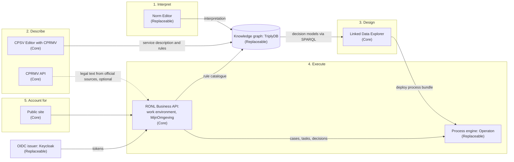

# 5. Application architecture

## What this chapter settles in your PSA

Which components IOU consists of, what role each has, and how they communicate.
Here you connect the steps from [chapter 2](02-context-and-scope.md) to the
components you install.

## What IOU decides

**One API layer between all portals and the process engine** (AB-13). The work
environment, MijnOmgeving and the public site talk only to the RONL Business API.
It checks who may do what, records it, and talks to the engine. The engine itself
is still directly reachable (risk R-01).

**The engine speaks the Camunda 7 REST API** (AB-14). IOU chooses Operaton.
Another engine with the same API is possible; an engine with a different API
(such as Camunda 8) means a rebuild.

**Shared artefacts live in a SPARQL triple store** (AB-16). IOU chooses TriplyDB;
that decision is under review.

**One OIDC issuer for all backends** (AB-17). IOU chooses Keycloak (AB-32, replaceable), which brokers
your organisation's login service and later DigiD and eHerkenning.

**A separate public layer that only reads** (AB-22), and **every component
manages its own data** (AB-25).

### The landscape

Every component sits at the step it belongs to. The tier is in brackets.

### The components

| Component | Role | Consists of | Tier |
|---|---|---|---|
| Norm Editor | Legal interpretation in FLINT | Web interface, backend, three services for text and language analysis | Replaceable |
| CPSV Editor | Describe and publish services and rules | Web interface; uses the Linked Data Explorer's backend for validation and publication | Core |
| CPRMV API | Fetch legal text and rules from official sources | One API service, without storage of its own | Core |
| Linked Data Explorer | Design and deploy decisions and processes; record of processing activities | Web interface, backend with its own database, public site for the record of processing activities | Core |
| RONL Business API | Execute cases; portals for staff and residents; public site | Backend with audit store; web interfaces for the work environment and MijnOmgeving; public site | Core |
| Process engine | Execute processes and decisions | Operaton | Replaceable |
| Knowledge graph | Store shared artefacts and make them queryable | TriplyDB | Replaceable |
| OIDC issuer | Login, roles, brokering other login services | Keycloak | Replaceable |

### How they communicate

| From | To | For | How |
|---|---|---|---|
| Web interfaces | Their own backend | All functions | HTTPS; the browser does not talk to the engine or knowledge graph itself |
| CPSV Editor | Knowledge graph | Publishing | HTTPS, through TriplyDB's API and the Linked Data Explorer's backend |
| Norm Editor | Knowledge graph | Storing interpretations | HTTPS, through TriplyDB's API |
| Linked Data Explorer | Knowledge graph | Finding decision models, consuming rules | SPARQL 1.1 |
| Linked Data Explorer | Process engine | Deploying process bundles; tasks the system performs itself | Camunda 7 REST API |
| RONL Business API | Process engine | Starting cases, completing tasks, evaluating decisions | Camunda 7 REST API |
| RONL Business API | Knowledge graph | Rule catalogue, process library | SPARQL 1.1, read live |
| RONL Business API | Linked Data Explorer | Published process bundles | REST; and still directly from the database as well (AB-25, risk R-09) |
| RONL Business API | CPRMV API | Legal text for the assistant | Deliberately off as long as the deployed version of the CPRMV API does not yet deliver the function it needs |
| Portals | RONL Business API | Login and actions | OIDC tokens from the issuer, checked by the backend |

A connection to a component that is still evolving is switched on only when the
deployed version delivers what the connection needs. Until then it stays off, and
the rest keeps working. This is how IOU can adopt a standard step by step (see
[About this PSA](index.md#how-iou-develops)).

The design tools do not use tokens yet (AB-20, risk R-02). Where the web
interfaces of the Linked Data Explorer, the CPSV Editor and the Norm Editor talk
to their backend, that backend therefore does not yet check who the user is.

## Phasing

| | Phase 1: staff | Prepare now | Phase 2: residents and businesses |
|---|---|---|---|
| Portals | Work environment | MijnOmgeving already exists as part of the RONL Business API | MijnOmgeving open to residents |
| API layer | Internal clients | All authorisation in the backend, not in the screen (AB-18) | Public clients as an extra user of the same API |
| Design tools | Staff only | Shield them behind your login service | Remain for staff only (AB-21) |

## What you fill in

- Which components you install yourself, and which you consume as a shared
  service.
- Whether you replace a replaceable component; if so, a deviation in chapter 11.
- How you map the IOU components onto your reference architecture.
- Which of your own systems connect to which components (see
  [chapter 7](07-integration-architecture.md)).

## Further reading

- [RONL Business API architecture at a glance](../ronl-business-api/index.md)
- [Linked Data Explorer architecture](../linked-data-explorer/developer/architecture.md)
- [CPSV Editor due diligence](../cpsv-editor/developer/due-diligence.md)
- [CPRMV API architecture](../cprmv-api/developer/architecture.md)
- [Norm Editor](../norm-editor/index.md)
