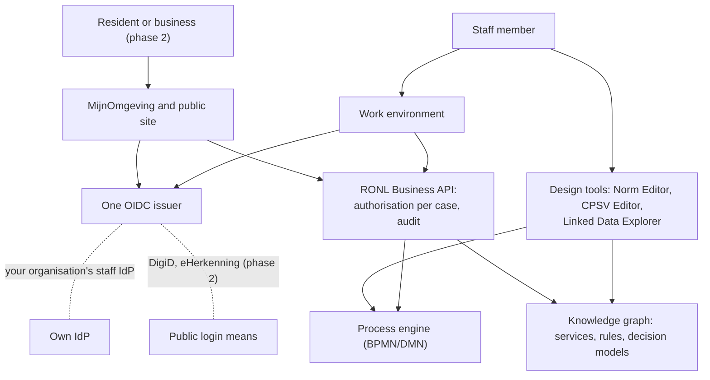

# About this Project Start Architecture

A Project Start Architecture (PSA, *Project Start Architectuur*) sets out the
architectural frameworks, design choices and preconditions within which an
application is built and run. This guide is **not** an organisation's PSA. It is
the basis on which you write the PSA for your own IOU implementation: for each
topic it states what IOU has already decided, how binding that decision is, how
far IOU itself has got with it, and what you fill in yourself.

The guide covers IOU as a whole: the Norm Editor, the CPSV Editor with CPRMV, the
Linked Data Explorer, the RONL Business API and the services around them. Its
structure follows that of a compact PSA for a municipal application, in eleven
chapters. The Dutch version is the original; this is its translation.

## Who it is for

For the architect who writes the PSA, and for those who assess it: the CISO, the
data protection officer, the operations organisation and the commissioning
principal. The guide assumes you intend to introduce IOU in a province,
municipality or executive agency, first for staff and later also for residents
and businesses.

## How to use this guide

Every chapter has the same fixed parts:

1. **What this chapter settles in your PSA**: the topic, in a few lines.
2. **What IOU decides**: the architectural decisions that apply to this topic.
3. **Phasing**: what must be ready in phase 1, what you prepare now, and what
   follows in phase 2. Only where it makes a difference.
4. **What you fill in**: the questions your own PSA must answer.
5. **Further reading**: the pages on this site with the details.

### Architectural decisions

Every decision has a fixed number, from AB-01 to AB-32 (*AB* for
*architectuurbesluit*). [Chapter 11](11-decisions-and-risks.md) lists them all in
the decision register; the other chapters refer to them. Use the same numbers in
your own PSA. A number never changes: if a decision lapses, its number stays,
marked as such.

### Three tiers

Every decision belongs to one of three tiers:

| Tier | Meaning |
|---|---|
| **Core** | You do not deviate from this. An organisation that does is no longer running IOU. |
| **Replaceable** | You may choose otherwise. You record it as a deviation in chapter 11 of your PSA, with the reason, the principle the choice conflicts with, and what it costs. |
| **Organisation's own** | IOU takes no position. The choice is your organisation's. |

The line between core and replaceable follows one rule: **whatever produces or
exchanges shared artefacts is core; whatever only runs or stores them inside one
organisation is replaceable.** Service descriptions, rules, decision models and
process models are shared with other organisations. Deviate there and you drop
out of the shared ecosystem. A process engine, an identity service or a triple
store affects only your own organisation.

A deviation from a replaceable decision is not a failure. "IOU, with an
exception" is better than a solution outside IOU: the shared artefacts and the
rest of the architecture remain usable.

Some decisions are **under review**: IOU may still change them itself. If you
choose the alternative now, you may later find yourself on IOU's path rather
than beside it.

### Status

Each decision shows how far IOU itself has got with it: **realised**, **partly**
or **not yet**. The status refers to the released version of every component,
because that is what you adopt. A decision is realised only when every component
it applies to meets it; the note says which components do and which do not.

IOU is not finished as a reference. Every decision that is partly or not yet
realised therefore also appears as a risk in chapter 11, with what you arrange
yourself in the meantime and the issue in which IOU resolves it.

## How IOU develops

IOU is also a way of working. It explores: learning to deal with complex
questions, where much is uncertain and unpredictable, through concrete solutions,
by recognising patterns and learning from them.

That applies to the standards IOU rests on as well. CPRMV is evolving, and IOU
adopts each version step by step. What IOU runs into along the way goes back as a
proposal to refine or change CPRMV. IOU thus shows how a standard and its use
grow together. A function that waits for a new version is deliberately switched
off until then; the rest of IOU keeps working.

A second example is DMN. Working regulations out into executable decision
services showed that the standard leaves three questions open: what identifies a
rule durably, how a decision model refers to the law it implements, and what a
model must be able to prove. A model can pass every check and still never give
the right outcome. IOU therefore proposes to Forum Standaardisatie, which also
owns CPRMV, a Dutch application profile for DMN:
[DMN-AP NL](https://github.com/sgort/ttl-editor/blob/main/docs/dmn-ap-nl-proposal.md).
The profile constrains DMN the way CPSV-AP does for CPSV, asks nothing of the
international standard, and is first tried on new regulations before anyone is
asked to adopt it.

This is IOU's first and most important architectural decision (AB-01).

For your PSA this means:

- statuses change. This guide is re-checked every week against the released
  versions, and the date at the top of every page says when that last happened;
- decisions that are **under review** may change;
- your organisation needs a way to follow those changes and carry them into your
  own PSA (see [chapter 10](10-management-and-continuity.md)).

## Staff first, residents later

Most organisations start with IOU for their own staff (phase 1) and later open
part of it to residents and businesses (phase 2). That second step must not
require a rebuild. It only works if a few choices are fixed from the start:

- login is separate from the business logic, so that another login service can
  be added later (AB-17);
- the backend checks per case who may see or do what, not the screen (AB-18);
- there is one secured API layer between all screens and the process engine
  (AB-13);
- the design tools remain for staff only; residents reach only the portals and
  the public site (AB-21).

Each chapter shows what this means for its topic.

## What this guide is not

- Not a functional or technical design. Screens, API specifications and database
  designs are on the pages the chapters refer to.
- Not evidence of compliance. A PSA describes choices and how frameworks are
  addressed; assessment, risk analysis and acceptance are done separately.
- Not a description of one organisation. Examples from a particular organisation
  appear only as examples of an organisation's own choice.
