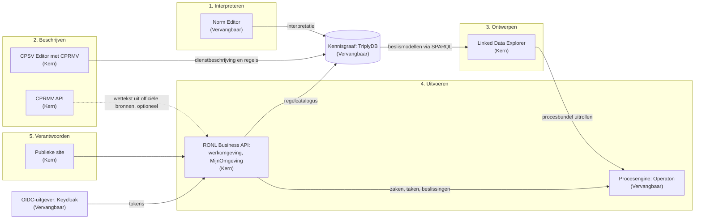

# 5. Applicatiearchitectuur

## Wat dit hoofdstuk in uw PSA vastlegt

Uit welke onderdelen IOU bestaat, welke rol elk onderdeel heeft, en hoe ze met
elkaar communiceren. Hier verbindt u de stappen uit
[hoofdstuk 2](02-context-and-scope.md) met de onderdelen die u installeert.

## Wat IOU beslist

**Eén API-laag tussen alle portalen en de procesengine** (AB-13). De werkomgeving,
MijnOmgeving en de publieke site praten alleen met de RONL Business API. Die
controleert wie iets mag, legt het vast, en praat met de engine. De engine zelf is
nog direct bereikbaar (risico R-01).

**De engine spreekt de Camunda 7 REST-API** (AB-14). IOU kiest Operaton. Een andere
engine met dezelfde API kan; een engine met een andere API (zoals Camunda 8)
betekent herbouw.

**Gedeelde producten staan in een SPARQL-triplestore** (AB-16). IOU kiest TriplyDB;
dat besluit is onder herziening.

**Eén OIDC-uitgever voor alle backends** (AB-17). IOU kiest Keycloak, dat de
inlogvoorziening van uw organisatie en later DigiD en eHerkenning achter zich
koppelt.

**Een aparte publieke laag die alleen leest** (AB-22), en **elk onderdeel beheert
zijn eigen gegevens** (AB-25).

### Het landschap

Elk onderdeel staat bij de stap waar het hoort. Tussen haakjes staat de laag.

### De onderdelen

| Onderdeel | Rol | Bestaat uit | Laag |
|---|---|---|---|
| Norm Editor | Juridische interpretatie in FLINT | Webinterface, backend, drie diensten voor tekst- en taalanalyse | Vervangbaar |
| CPSV Editor | Diensten en regels beschrijven en publiceren | Webinterface; gebruikt de backend van de Linked Data Explorer voor validatie en publicatie | Kern |
| CPRMV API | Wettekst en regels ophalen uit officiële bronnen | Eén API-dienst, zonder eigen opslag | Kern |
| Linked Data Explorer | Beslissingen en processen ontwerpen en uitrollen; verwerkingsregister | Webinterface, backend met eigen database, publieke site voor het verwerkingsregister | Kern |
| RONL Business API | Zaken uitvoeren; portalen voor medewerkers en inwoners; publieke site | Backend met auditopslag; webinterfaces voor werkomgeving en MijnOmgeving; publieke site | Kern |
| Procesengine | Processen en beslissingen uitvoeren | Operaton | Vervangbaar |
| Kennisgraaf | Gedeelde producten opslaan en bevraagbaar maken | TriplyDB | Vervangbaar |
| OIDC-uitgever | Inloggen, rollen, koppeling met andere inlogvoorzieningen | Keycloak | Vervangbaar |

### Hoe ze communiceren

| Van | Naar | Waarvoor | Hoe |
|---|---|---|---|
| Webinterfaces | Hun eigen backend | Alle functies | HTTPS; de browser praat niet zelf met engine of kennisgraaf |
| CPSV Editor | Kennisgraaf | Publiceren | HTTPS, via de API van TriplyDB en de backend van de Linked Data Explorer |
| Norm Editor | Kennisgraaf | Interpretaties opslaan | HTTPS, via de API van TriplyDB |
| Linked Data Explorer | Kennisgraaf | Beslismodellen vinden, regels afnemen | SPARQL 1.1 |
| Linked Data Explorer | Procesengine | Procesbundels uitrollen; taken die het systeem zelf uitvoert | Camunda 7 REST-API |
| RONL Business API | Procesengine | Zaken starten, taken afhandelen, beslissingen berekenen | Camunda 7 REST-API |
| RONL Business API | Kennisgraaf | Regelcatalogus, procesbibliotheek | SPARQL 1.1, live gelezen |
| RONL Business API | Linked Data Explorer | Gepubliceerde procesbundels | REST; daarnaast nog rechtstreeks uit de database (AB-25, risico R-09) |
| RONL Business API | CPRMV API | Wettekst voor de assistent | Staat bewust uit zolang de uitgerolde versie van de CPRMV API de benodigde functie nog niet levert |
| Portalen | RONL Business API | Inloggen en handelingen | OIDC-tokens van de uitgever, gecontroleerd door de backend |

Een koppeling met een onderdeel dat nog in ontwikkeling is, gaat pas aan als de
uitgerolde versie levert wat de koppeling nodig heeft. Tot dan staat ze uit, en
werkt de rest gewoon door. Zo kan IOU een standaard stap voor stap overnemen
(zie [Over deze PSA](index.md#hoe-iou-zich-ontwikkelt)).

De ontwerptools gebruiken nog geen tokens (AB-20, risico R-02). Waar de
webinterfaces van de Linked Data Explorer, de CPSV Editor en de Norm Editor met hun
backend praten, controleert die backend dus nog niet wie de gebruiker is.

## Fasering

| | Fase 1: medewerkers | Nu voorbereiden | Fase 2: inwoners en ondernemers |
|---|---|---|---|
| Portalen | Werkomgeving | MijnOmgeving bestaat al als onderdeel van de RONL Business API | MijnOmgeving open voor inwoners |
| API-laag | Interne clients | Alle autorisatie in de backend, niet in het scherm (AB-18) | Publieke clients als extra gebruiker van dezelfde API |
| Ontwerptools | Alleen medewerkers | Afschermen achter uw inlogvoorziening | Blijven alleen voor medewerkers (AB-21) |

## Wat u invult

- Welke onderdelen u installeert, en welke u gedeeld afneemt.
- Of u een vervangbaar onderdeel vervangt; zo ja, een afwijking in hoofdstuk 11.
- Hoe u de IOU-onderdelen afbeeldt op uw referentiearchitectuur.
- Welke van uw eigen systemen aan welke onderdelen koppelen
  (zie [hoofdstuk 7](07-integration-architecture.md)).

## Verder lezen

- [Architectuur van de RONL Business API in één oogopslag](../ronl-business-api/index.md)
- [Architectuur van de Linked Data Explorer](../linked-data-explorer/developer/architecture.md)
- [Due diligence van de CPSV Editor](../cpsv-editor/developer/due-diligence.md)
- [Architectuur van de CPRMV API](../cprmv-api/developer/architecture.md)
- [Norm Editor](../norm-editor/index.md)
