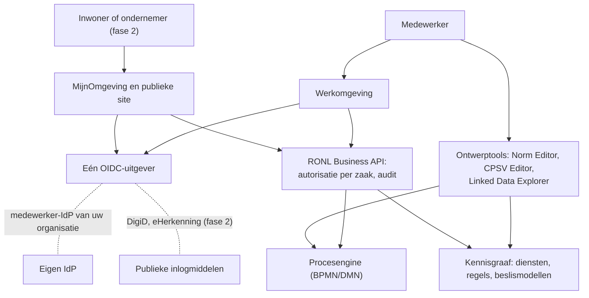

# Over deze Project Start Architectuur

Een Project Start Architectuur (PSA) legt vast binnen welke architectuurkaders,
ontwerpkeuzes en randvoorwaarden een toepassing wordt gebouwd en beheerd. Deze
gids is **niet** de PSA van een organisatie. Het is de basis waarop u de PSA voor
uw eigen IOU-implementatie schrijft: per onderwerp staat hier wat IOU al heeft
besloten, hoe bindend dat besluit is, hoe ver IOU er zelf mee is, en wat u zelf
moet invullen.

De gids beschrijft IOU als geheel: de Norm Editor, de CPSV Editor met CPRMV, de
Linked Data Explorer, de RONL Business API en de voorzieningen eromheen. De
indeling volgt die van een compacte PSA voor een gemeentelijke toepassing, in elf
hoofdstukken.

## Voor wie

Voor de architect die de PSA schrijft, en voor wie de PSA beoordeelt: de CISO,
de functionaris gegevensbescherming, de beheerorganisatie en de opdrachtgever. De
gids gaat ervan uit dat u IOU wilt invoeren in een provincie, gemeente of
uitvoeringsorganisatie, eerst voor medewerkers en later ook voor inwoners en
ondernemers.

## Hoe u deze gids gebruikt

Elk hoofdstuk heeft dezelfde vaste onderdelen:

1. **Wat dit hoofdstuk in uw PSA vastlegt**: het onderwerp, in een paar regels.
2. **Wat IOU beslist**: de architectuurbesluiten die voor dit onderwerp gelden.
3. **Fasering**: wat in fase 1 klaar moet zijn, wat u nu al voorbereidt en wat in
   fase 2 volgt. Alleen waar dat verschil maakt.
4. **Wat u invult**: de vragen die uw eigen PSA moet beantwoorden.
5. **Verder lezen**: de pagina's op deze site met de details.

### Architectuurbesluiten

Elk besluit heeft een vast nummer, van AB-01 tot en met AB-32. In
[hoofdstuk 11](11-decisions-and-risks.md) staan ze allemaal in het
besluitenregister; de andere hoofdstukken verwijzen ernaar. Neem de nummers over
in uw eigen PSA. Een nummer verandert nooit: vervalt een besluit, dan blijft het
nummer staan met die vermelding.

### Drie lagen

Elk besluit hoort bij één van drie lagen:

| Laag | Betekenis |
|---|---|
| **Kern** | Hier wijkt u niet van af. Een organisatie die dat wel doet, gebruikt geen IOU meer. |
| **Vervangbaar** | U mag een andere keuze maken. U legt die vast als afwijking in hoofdstuk 11 van uw PSA, met de reden, het principe waarmee de keuze botst en wat ze kost. |
| **Eigen keuze** | IOU heeft hier geen standpunt. De keuze is aan uw organisatie. |

De grens tussen kern en vervangbaar volgt één regel: **wat gedeelde producten
maakt of uitwisselt, is kern; wat ze alleen binnen één organisatie uitvoert of
opslaat, is vervangbaar.** Dienstbeschrijvingen, regels, beslismodellen en
procesmodellen deelt u met andere organisaties. Wijkt u daar af, dan valt u uit
het gedeelde stelsel. Een procesengine, een identiteitsvoorziening of een
triplestore raakt alleen uw eigen organisatie.

Een afwijking op een vervangbaar besluit is geen falen. "IOU, met een
uitzondering" is beter dan een oplossing buiten IOU: de gedeelde producten en
de rest van de architectuur blijven dan bruikbaar.

Sommige besluiten zijn **onder herziening**: IOU kan ze zelf nog wijzigen. Kiest
u nu al het alternatief, dan kan het zijn dat u straks op het pad van IOU zit in
plaats van ernaast.

### Status

Bij elk besluit staat hoe ver IOU er zelf mee is: **gerealiseerd**, **deels** of
**nog niet**. De status gaat over de vrijgegeven versie van alle componenten,
want dat is wat u overneemt. Een besluit is pas gerealiseerd als elk onderdeel
waarvoor het geldt eraan voldoet; de toelichting noemt welke onderdelen dat wel
en niet doen.

IOU is als referentie nog niet af. Elk besluit dat deels of nog niet is
gerealiseerd, staat daarom ook als risico in hoofdstuk 11, met wat u in de
tussentijd zelf regelt en het issue waarin IOU het oplost.

## Hoe IOU zich ontwikkelt

IOU is ook een manier van werken. Het verkent: met concrete oplossingen leren
omgaan met complexe vraagstukken, waar veel onzeker en onvoorspelbaar is, door
patronen te herkennen en daarvan te leren.

Dat geldt ook voor de standaarden waarop IOU rust. CPRMV ontwikkelt zich, en IOU
neemt elke versie stap voor stap over. Wat IOU daarbij tegenkomt, gaat terug als
voorstel om CPRMV te verfijnen of aan te passen. IOU laat dus zien hoe een
standaard en zijn gebruik samen groeien. Een functie die op een nieuwe versie
wacht, staat zolang bewust uit; de rest van IOU werkt door.

Een tweede voorbeeld is DMN. Bij het uitwerken van regelgeving tot uitvoerbare
beslisdiensten bleek dat de standaard drie vragen open laat: wat een regel
blijvend identificeert, hoe een beslismodel verwijst naar de wet die het
uitvoert, en wat een model moet kunnen aantonen. Een model kan alle controles
doorstaan en toch nooit de juiste uitkomst geven. IOU stelt daarom aan Forum
Standaardisatie, dat ook eigenaar is van CPRMV, een Nederlands toepassingsprofiel
voor DMN voor: [DMN-AP NL](https://github.com/sgort/ttl-editor/blob/main/docs/dmn-ap-nl-voorstel.md). Het profiel beperkt DMN zoals CPSV-AP dat
doet voor CPSV, vraagt niets van de internationale standaard, en wordt eerst
beproefd op nieuwe regelgeving voordat iemand wordt gevraagd het over te nemen.

Dit is het eerste en belangrijkste architectuurbesluit van IOU (AB-01).

Voor uw PSA betekent dat:

- statussen veranderen. Deze gids wordt elke week opnieuw gecontroleerd tegen de
  vrijgegeven versies, en de datum bovenaan elke pagina zegt wanneer dat het
  laatst gebeurde;
- besluiten die **onder herziening** staan, kunnen wijzigen;
- uw organisatie heeft een manier nodig om die veranderingen te volgen en door te
  voeren in uw eigen PSA (zie [hoofdstuk 10](10-management-and-continuity.md)).

## Eerst voor medewerkers, later voor inwoners

De meeste organisaties beginnen met IOU voor hun eigen medewerkers (fase 1) en
openen later een deel ervan voor inwoners en ondernemers (fase 2). Die tweede
stap mag geen verbouwing vragen. Dat lukt alleen als een paar keuzes vanaf het
begin vastliggen:

- inloggen staat los van de bedrijfslogica, zodat er later een andere
  inlogvoorziening bij kan (AB-17);
- de backend controleert per zaak wie iets mag zien of doen, niet het scherm
  (AB-18);
- er is één beveiligde API-laag tussen alle schermen en de procesengine (AB-13);
- de ontwerptools blijven alleen voor medewerkers; inwoners komen alleen bij de
  portalen en de publieke site (AB-21).

Elk hoofdstuk laat zien wat dit voor dat onderwerp betekent.

## Wat deze gids niet is

- Geen functioneel of technisch ontwerp. Schermen, API-specificaties en
  databaseontwerpen staan op de pagina's waarnaar de hoofdstukken verwijzen.
- Geen bewijs van naleving. Een PSA beschrijft keuzes en hoe kaders worden
  geadresseerd; toetsing, risicoanalyse en acceptatie doet u apart.
- Geen beschrijving van één organisatie. Voorbeelden uit een bepaalde organisatie
  staan er alleen als voorbeeld van een eigen keuze.
